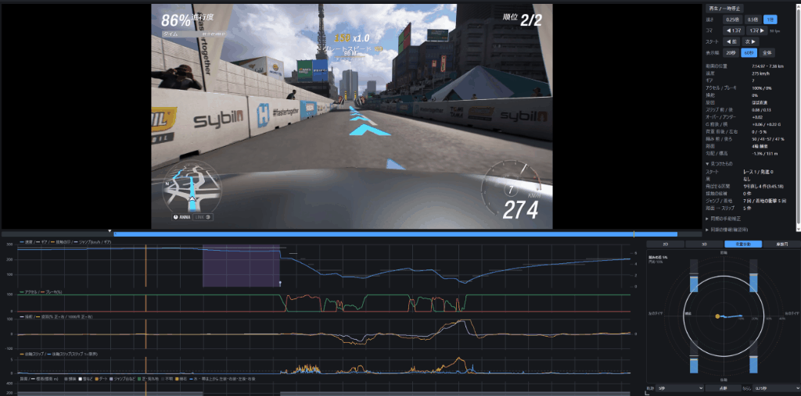

# HEISO Solo

> **About this document:** This is a machine translation of the Japanese [README.md](README.md). The screenshots and animations show the Japanese version of the apps.
> If this translation and the Japanese original differ, the Japanese original is correct.

HEISO Solo is a Windows app that records racing-game telemetry together with a video recording, and lets you review a run with **the video and graphs side by side**.
It currently supports Forza Horizon 6 (PC).

- Recorder (`HeisoRecorder`): starts and stops recording the telemetry the game sends (Data Out) together with an OBS Studio recording, from a browser on your PC or smartphone
- Player (`HeisoPlayer`): plays the recording and shows, for the same moment, speed, pedals, steering, gear, slip, road surface and more on graphs, and where you were on a course map



"Solo" is the edition for looking at one run of your own. Comparing two runs on the same course side by side ("HEISO", meaning "running side by side") will come in a later version.

## What it can do

**Recording**
- Start and stop telemetry logging and the OBS recording together with one button (also from a smartphone)
- Choose the recording quality in steps (Minimum to High). The OBS profile is switched only while recording
- Choose the scene to record. Even if another scene is selected in OBS, HEISO switches to the game scene only while recording
- Detects car changes and race starts/finishes automatically, and names cars, setups and courses

**Playback**
- Shows the current video position with a pointer on the graphs and an arrow on the course map. Click a graph to jump to that moment
- X axis by time or distance. Runs redone with rewind are left out, so the race is shown as the one run that made it to the finish
- Marks starts, contacts, landings, jumps, laps and places where you left the road, and jumps to the previous/next mark
- Skips redone sections (rewinds, missed checkpoints) and pauses (photo mode, menus) while playing
- Course map in 2D and 3D (with elevation, including a chase view). Can be colored by road surface
- Slow motion and frame stepping. If the video and graphs are slightly off, you can align them by hand and save it
- Assign the game's replay recorded after a race, or a separately recorded video (Game Bar, etc.), to a race, and switch between them

**Display**
- Japanese and English (follows the Windows display language, or choose in Settings)
- Units for speed, distance and elevation: km/h and m, or mph, ft and mi

**Sharing**
- Export one race as a single file (`.heiso.zip`) with the video, telemetry and information. Anyone can open it in the Player as is

## Requirements

- Windows 11 (x64)
- Forza Horizon 6 (PC)
- OBS Studio 31 or later (tested with 32)
- .NET 10 runtime: not needed with the zip that includes the runtime. With the zip without the runtime, you need the .NET Desktop Runtime (Player) and the ASP.NET Core Runtime (Recorder), both x64
- Microsoft Edge WebView2 Runtime (included in Windows 11)

## Installation and usage

- Installation: [docs/en/install.md](docs/en/install.md)
- Usage: [docs/en/usage.md](docs/en/usage.md)

Ready-to-use builds are on the GitHub Releases page. Usually choose `HEISO-<version>-win-x64.zip`, which includes the .NET runtime (about 125 MB; just extract and run). If you already have .NET 10, choose the smaller `HEISO-<version>-win-x64-light.zip` (about 17 MB).

## Building from source

With the .NET 10 SDK (or Visual Studio 2026):

```
dotnet build csharp/HEISO.slnx
dotnet test csharp/HEISO.slnx
```

The formats of the recorded data (`session.json`, `telemetry.csv.gz`) and the distribution package are described in [docs/session-format.md](docs/session-format.md) (Japanese).

## License

[MIT](LICENSE). Licenses of the bundled components are in [THIRD-PARTY-NOTICES.md](THIRD-PARTY-NOTICES.md).

Forza Horizon is a trademark of Microsoft Corporation. HEISO is an unofficial tool and is not affiliated with Microsoft or Playground Games.

## Game content

The images in this README and the documents, the videos recorded with the Recorder, and distribution packages contain footage from Forza Horizon 6.
Use them non-commercially, following Microsoft's "[Game Content Usage Rules](https://www.xbox.com/en-US/developers/rules)".
Content owned by parties other than Microsoft, such as licensed music in the game, is not covered by these rules.

Forza Horizon 6 © Microsoft Corporation. HEISO was created under Microsoft's "[Game Content Usage Rules](https://www.xbox.com/en-US/developers/rules)" using assets from Forza Horizon 6, and it is not endorsed by or affiliated with Microsoft.
