# Installing HEISO Solo

> **About this document:** This is a machine translation of the Japanese [install.md](../install.md). The screenshots show the Japanese versions of the apps, OBS Studio and the game, so the labels in the images are in Japanese. In the text, the English label is followed by the Japanese label in parentheses where that helps you find it in a screenshot.
> If this translation and the Japanese original differ, the Japanese original is correct.

HEISO consists of two apps: the Recorder (`HeisoRecorder`) and the Player (`HeisoPlayer`).
If you install and set things up in the order of this document, you can record the game's telemetry together with an OBS recording and watch it in the Player.

Usage is described in [usage.md](usage.md).

## 1. Requirements

| Software / environment | Notes |
|---|---|
| Windows 11 (x64) |  |
| Forza Horizon 6 (PC) | Uses the game's telemetry output (Data Out) |
| OBS Studio 31 or later | Used for recording. Tested with 32. HEISO controls OBS through its WebSocket server (obs-websocket) |
| .NET 10 runtime | Not needed with the zip that includes the runtime (see "2." below) |
| Microsoft Edge WebView2 Runtime | Included in Windows 11 |
| ffmpeg | Needed only if you want to export at 720p after recording at a higher resolution (see "8." below) |

If you only use the Player (to watch packages you received), you don't need OBS or the game.

## 2. Put HEISO in place

There are two zip files on the GitHub Releases page. **Usually choose the first one, which includes the runtime.**

| zip | Size | Contents |
|---|---|---|
| `HEISO-<version>-win-x64.zip` | about 125 MB | Includes the .NET runtime. Just extract and run |
| `HEISO-<version>-win-x64-light.zip` | about 17 MB | Without the runtime. Install the .NET 10 runtime separately (see "3." below). For people who already have .NET 10 |

1. Download one of the zip files (`SHA256SUMS.txt` contains values for checking that the zip is not damaged)
2. Before extracting, right-click the zip → Properties → check "Unblock" at the bottom → OK
   (This removes the mark for files from the internet. Without it, you may get a warning every time you start the apps)
3. Extract it anywhere you like and give it an easy name, for example `C:\HEISO`
   - Avoid `Program Files` (changing the settings files there needs administrator rights)

After extracting, it looks like this:

```
C:\HEISO\
  HeisoRecorder\   Recorder (HeisoRecorder.exe)
  HeisoPlayer\     Player (HeisoPlayer.exe)
  docs\            These documents
  README.md / LICENSE / THIRD-PARTY-NOTICES.md / CHANGELOG.md
```

The first time you start an app, Windows may show "Windows protected your PC" (because the apps are not signed).
Click "More info" → "Run anyway" to start it.

## 3. Install the .NET 10 runtime (only with the zip without the runtime)

From Microsoft's .NET 10 download page (https://dotnet.microsoft.com/download/dotnet/10.0), install the following two. For both, choose the "x64" installer for "Windows".

| Runtime | Used by |
|---|---|
| .NET Desktop Runtime 10 | Player |
| ASP.NET Core Runtime 10 | Recorder |

- If you only use the Player, the Desktop Runtime alone is enough
- If you forget to install it, Windows tells you ".NET is required" when you start the app, and shows where to download it
- With the zip that includes the runtime, fixes to .NET are delivered as new versions of HEISO. With the zip without the runtime, .NET fixes come through Microsoft Update

## 4. Prepare OBS

### Install OBS

On the OBS Studio website (https://obsproject.com/download), choose Windows and install it with "Download Installer".

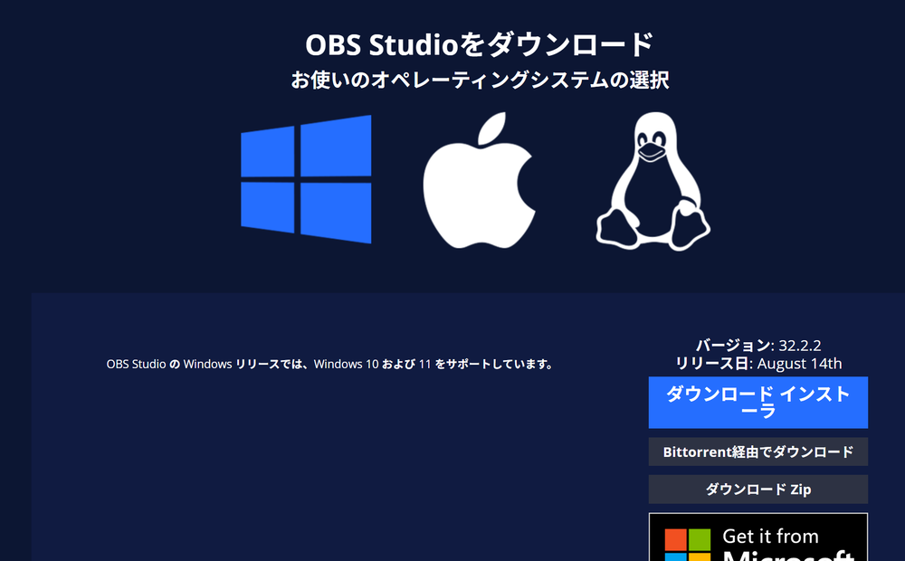

When the installation is finished, leave "Launch OBS Studio" checked and click "Finish" to start OBS.

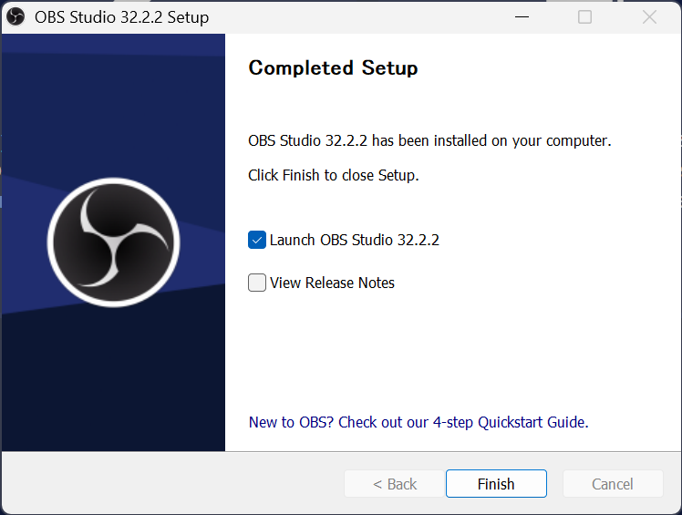

### Auto-Configuration Wizard

The first time OBS starts, the Auto-Configuration Wizard appears (you can also open it later from Tools → Auto-Configuration Wizard).

1. Usage information: "**Optimize just for recording, I will not be streaming**"
   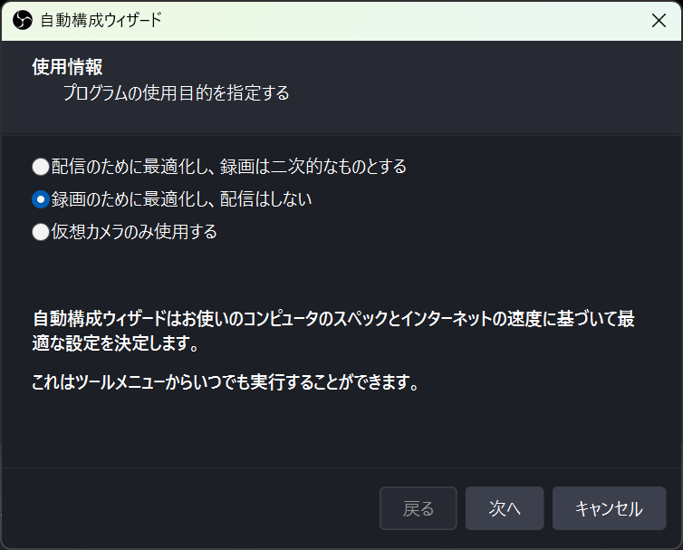
2. Leave the video settings as they are (base resolution is your current screen; FPS is "Either 60 or 30, but prefer 60 when possible")
   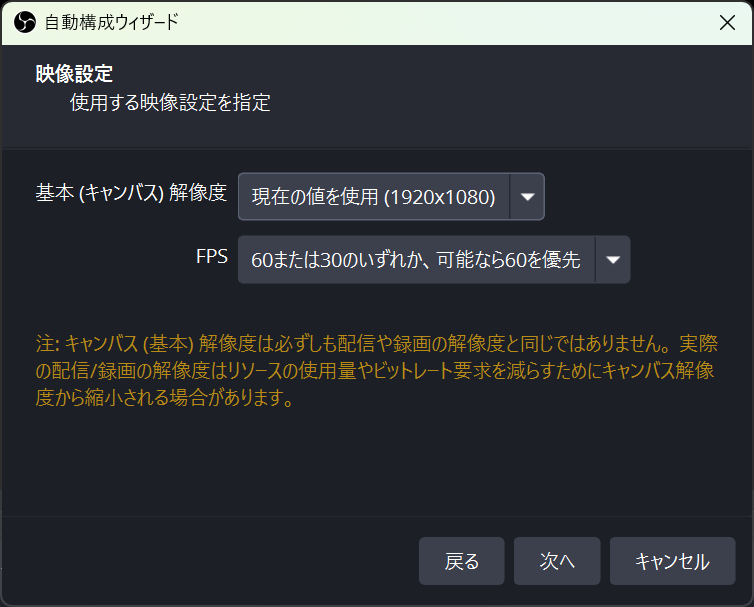
3. On the final results, click "Apply Settings". If a GPU encoder is chosen ("Hardware (NVENC, H.264)" for NVIDIA, AMF for AMD, QSV for Intel), recording puts little load on the PC while you play
   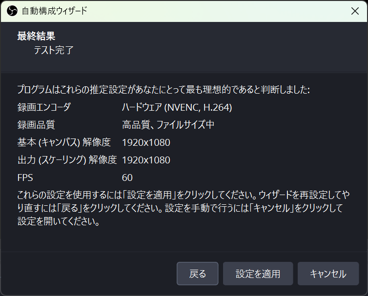

### Create a scene for HEISO (Game Capture)

**Create one scene** for recording with HEISO, and add a Game Capture source to it.
The Recorder switches OBS to this scene only while recording, and switches back to the previous scene when recording ends (see "Automatic switching to the HEISO scene" below).

1. In "Scenes" at the bottom, click "+" to create a new scene. Give it an easy name, for example `HEISO`
2. Select the new scene, click "+" under "Sources" → "Game Capture", and set the mode to "**Capture any fullscreen application**"
   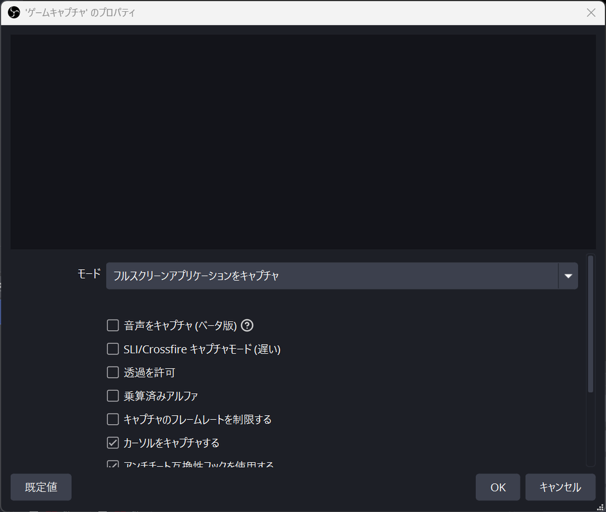
3. When you start the game, the game screen appears in the OBS preview
   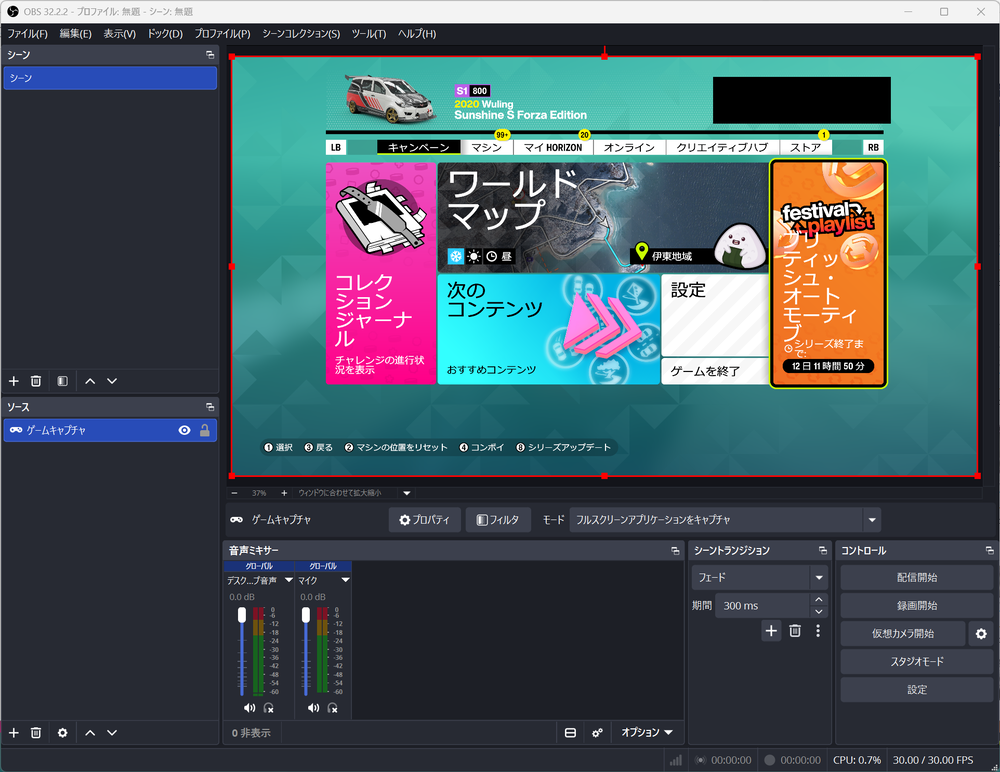

If you are new to OBS, you can also add the Game Capture to the scene that already exists ("Scene"). In that case, that scene is your HEISO scene.

### Automatic switching to the HEISO scene (for people who use OBS for streaming, etc.)

**The Recorder switches OBS to the HEISO setup only while recording, and switches it back when recording ends.**
It switches these two things:

| What is switched | What changes | Where to choose it in the Recorder |
|---|---|---|
| Scene | What is captured (the HEISO scene = Game Capture) | **Scene to record** (録画するシーン) |
| Profile | The recording quality (resolution, fps, file size; the "HEISO …" profiles below) | **Recording quality** (録画の画質) |

- If you already use OBS for streaming or other things, **you don't need to change your usual scenes or profiles for HEISO**. Just add one HEISO scene and choose it in **Scene to record** in the Recorder
- Even if your usual scene (a streaming layout, a screen-capture scene, etc.) is selected in OBS, recording starts in the HEISO scene when you start recording
- If **Scene to record** is left as **OBS's current scene** (OBS で今選んでいるシーン), nothing is switched. The scene selected in OBS at that time is recorded as is
- **Don't record while streaming.** The OBS scene changes while recording, so your stream also changes to the HEISO scene
- If the Recorder crashes, it switches OBS back to the previous scene and profile the next time it connects to OBS
- How to choose is described in "Scene to record" in [usage.md](usage.md)

### Video and output settings

Settings → Video: leave the Base (Canvas) Resolution at your screen's resolution, set the Output (Scaled) Resolution to 1920x1080, and use 30 for FPS as a guide (with a 4K screen, the recording is scaled down to 1080p).

With a 4K screen, keep the Base (Canvas) Resolution at 3840x2160, the same as the screen, and set the Output (Scaled) Resolution to 1920x1080. Match the Base (Canvas) Resolution to the resolution of the screen you use.

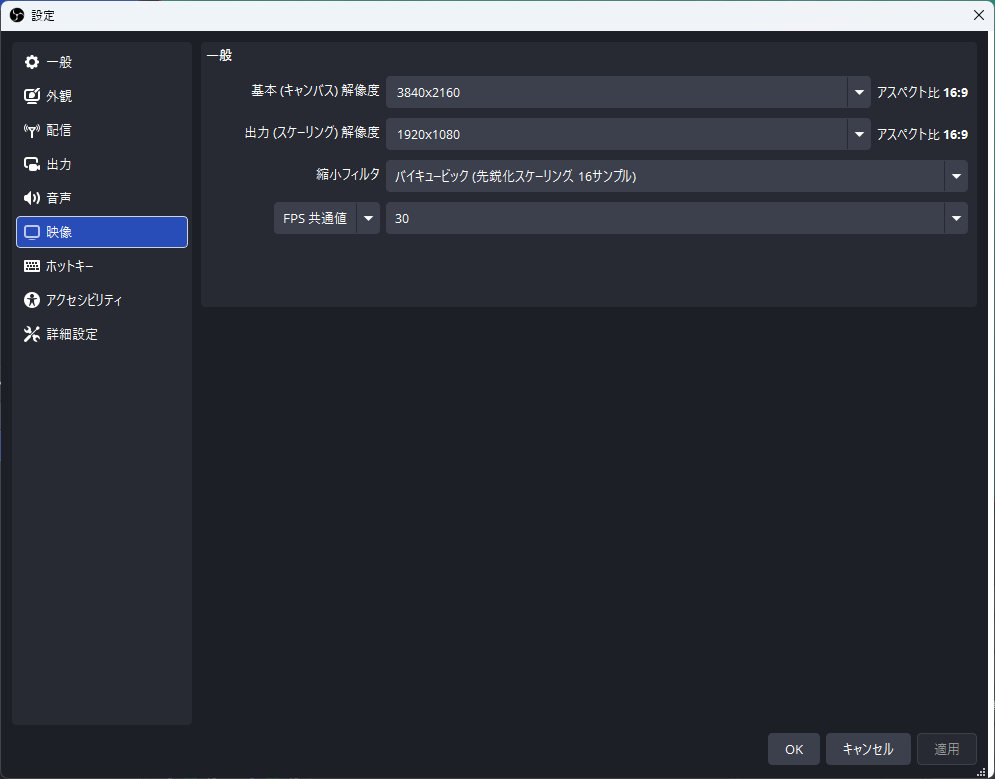

Settings → Output: leave the Output Mode at "**Simple**", and set the Recording Format to "**Hybrid MP4 (.mp4)**" (a format that is less likely to break if OBS crashes while recording).
The recording path can be anywhere. The Recorder switches it to the recording's folder only while recording.

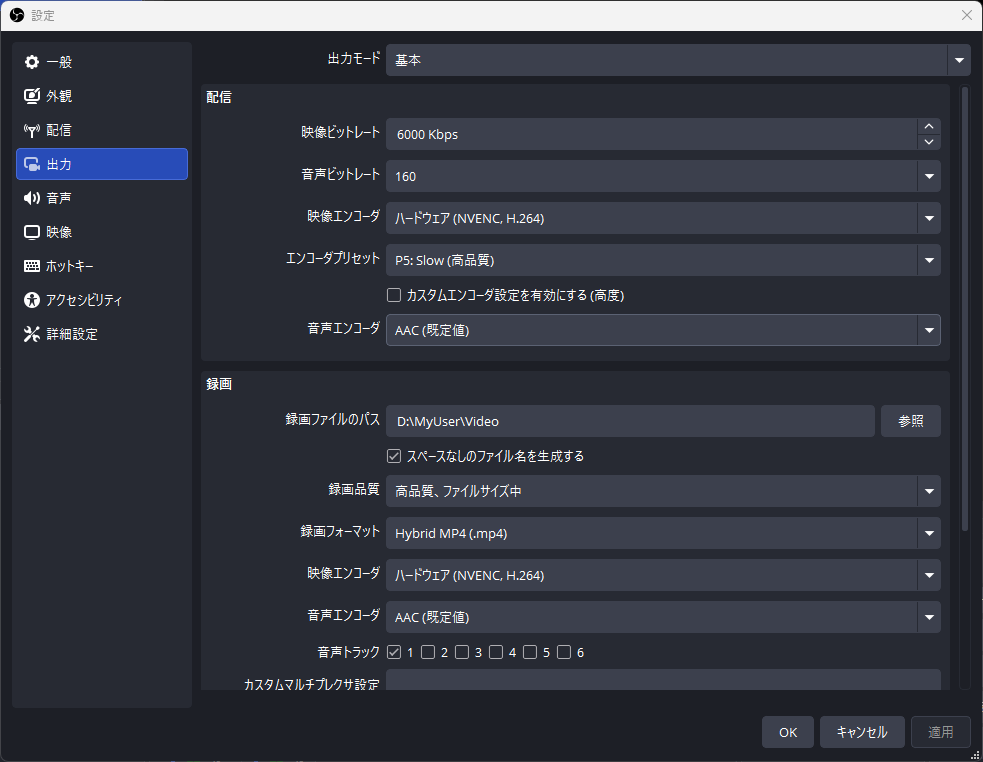

### Enable the WebSocket server

The Recorder starts and stops recording through OBS's WebSocket server.

1. In OBS, Tools → WebSocket Server Settings
2. Turn on "Enable WebSocket server". Leave the server port at 4455
3. If you turned on "Enable Authentication", **note the password** (you can see it with "Show Connect Info"; it is used in "5." below)

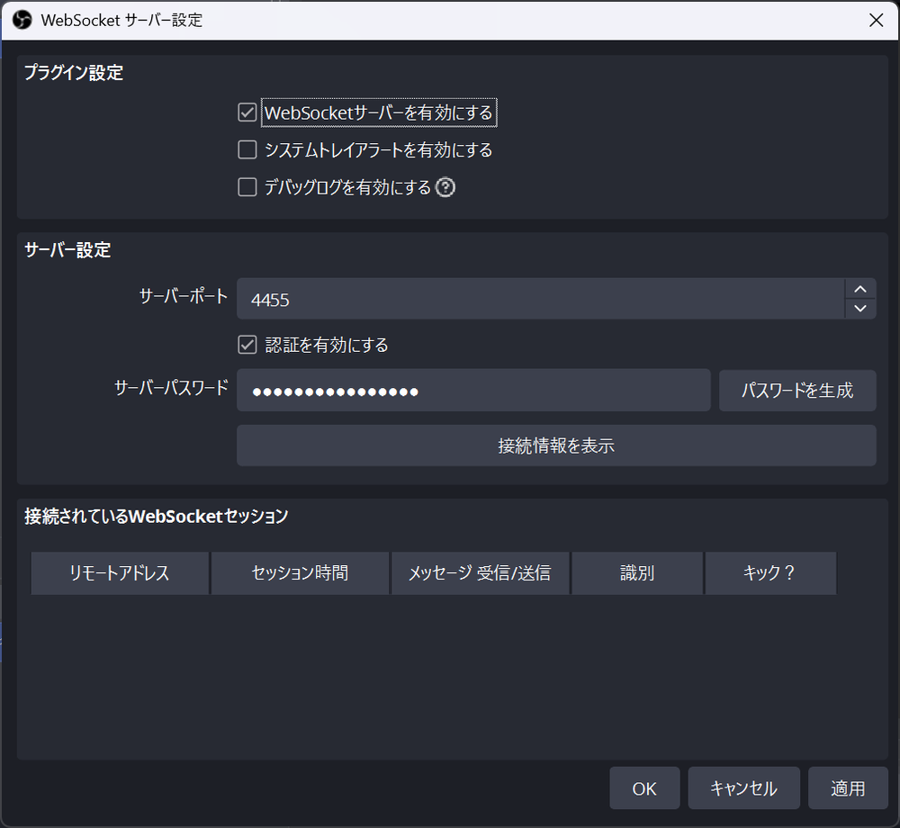

### Create the quality profiles (recommended)

In the Recorder you can choose the recording quality in steps (Minimum, Light, Medium, Standard, High). Create the OBS profiles "HEISO …" for these steps once, as follows:

1. Check that the Output Mode in OBS's Settings → Output is "Simple" (the profiles are made from the "Simple" settings)
2. **Close OBS** (if you create them while OBS is running, OBS overwrites them when it exits)
3. Open the `HeisoRecorder` folder, type `cmd` in the address bar and press Enter (a Command Prompt opens in that folder)
4. Type the following and press Enter

```
HeisoRecorder --setup-obs-profiles
```

5. When five lines like "HEISO Minimum: created…" appear, it is done. When you start OBS, the "HEISO …" profiles are listed in the "Profile" menu

- The profiles are copied from your current OBS profile. Your original profile is not changed
- The HEISO profiles use a keyframe interval of 1 second (so that the start of a clip can be cut cleanly when exporting)
- You can record without them (in that case the recording uses **OBS settings as they are** (OBS の設定のまま))
- The profile names follow the Recorder's language at the time you create them (in Japanese they are "HEISO 軽量" and so on)

To check, choose "HEISO Light" or another one under "Profile" in OBS and open Settings → Output. If the Output Mode is "Advanced" and the keyframe interval on the "Recording" tab is "1 s", it was created correctly (switch back to your original profile after checking).

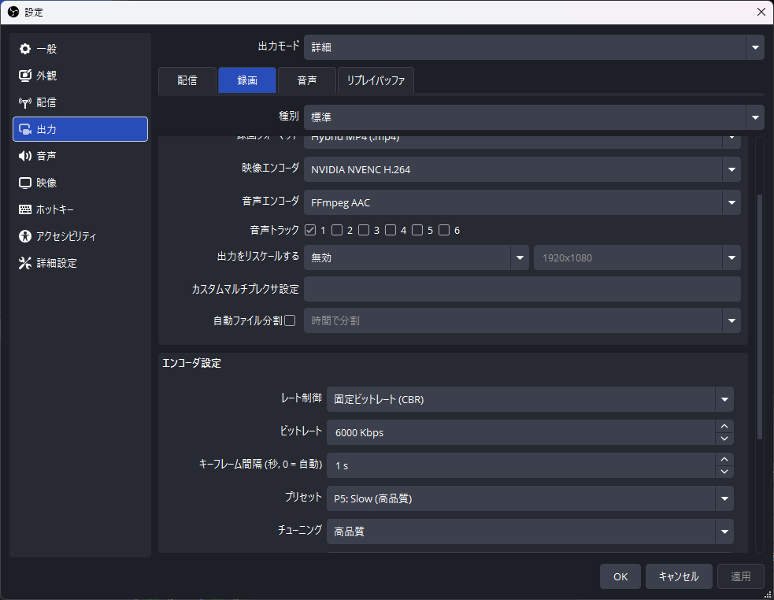

| Step | Resolution / fps | Approximate size |
|---|---|---|
| Minimum | 540p / 30 | about 19 MB/min |
| Light | 720p / 30 | about 45 MB/min |
| Medium | 1080p / 30 | about 75 MB/min |
| Standard | 1080p / 30 (higher quality) | about 125 MB/min |
| High | 1080p / 60 | about 250 MB/min |

### Try recording with OBS alone

Before using HEISO, check that OBS alone can record the game. If you can record here, recording started from HEISO works the same way.

1. In Settings → Hotkeys, assign keys to "Start Recording" and "Stop Recording" (for example `Ctrl + F9` for both). You can then start and stop recording with the key while the game is in full screen
   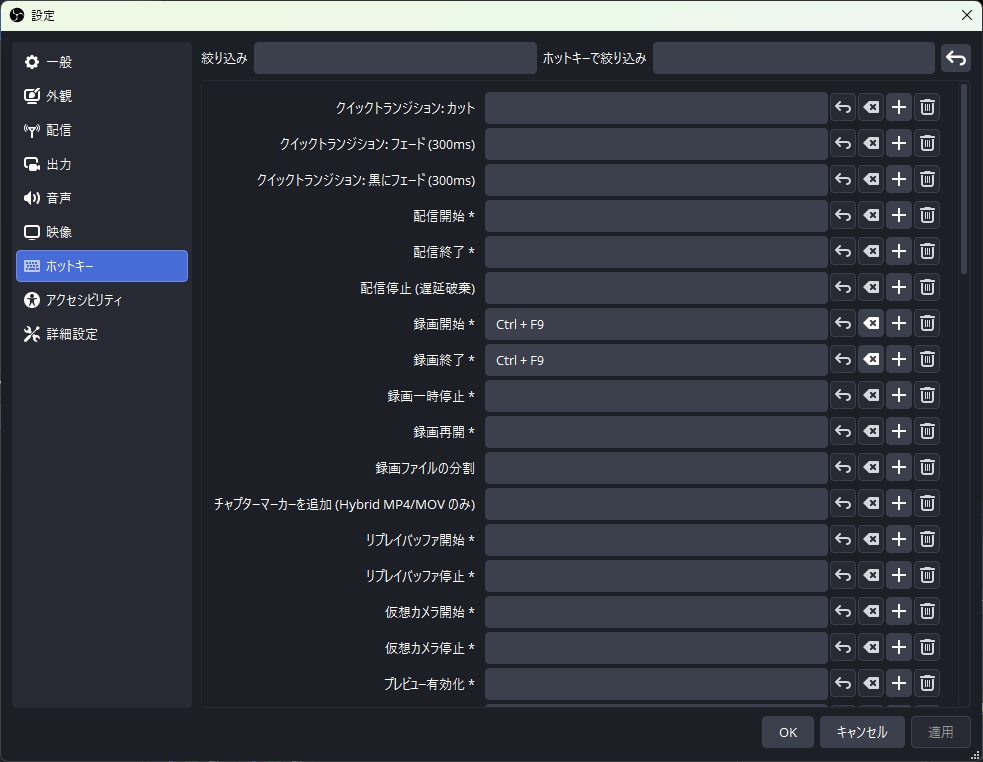
2. If you created the HEISO profiles, choose the one to use under "Profile" in OBS (for example "HEISO Light")
3. Select the HEISO scene in OBS (for example `HEISO`), start the game, and check that the game appears in the OBS preview
4. Drive a little in the game, start recording with the assigned key, and stop it after about 30 seconds
5. In OBS, File → Show Recordings to open the recordings folder, and play the mp4

- If the game screen is there and the video doesn't stutter, you're ready. After checking, switch the profile and scene back to the original ones (when recording with HEISO, the Recorder switches them automatically)
- If it is all black, check the Game Capture mode, or switch the game to windowed mode once and back to full screen
- If the game gets heavy while recording, lower the quality step, or set the FPS in Settings → Video to 30

## 5. Recorder settings (OBS password)

Needed only if you turned on authentication for OBS's WebSocket.

1. In the `HeisoRecorder` folder, copy `appsettings.Local.example.json` and rename the copy to `appsettings.Local.json`
2. Open it in Notepad and change the value of `"Password"` to OBS's WebSocket password
3. `"OutputDir"` is the folder where recordings are saved. If the default ("Videos\FH6Recorder") is fine, delete that line. To use another place, change it (write `\` as `\\`)

```json
{
  "Recorder": {
    "UdpPort": 5400,
    "Obs": {
      "Password": "OBS WebSocket password"
    }
  }
}
```

You can also set the Recorder's display language and speed unit here (if you don't, they are chosen automatically).

| Item | Value |
|---|---|
| `Language` | `auto` (Japanese if the Windows display language is Japanese, otherwise English) / `ja` / `en` |
| `SpeedUnit` | `auto` (mph if the Windows region is the US or the UK, otherwise km/h) / `kmh` / `mph` |

```json
{
  "Recorder": {
    "Language": "en",
    "SpeedUnit": "mph"
  }
}
```

The Player's language and units are chosen in the Player's **Settings** → **Display**.

## 6. Prepare the game (Data Out)

In Forza Horizon 6, under Settings → HUD and Gameplay, at the very bottom under "Telemetry":

| Item | Value |
|---|---|
| Data Out | On |
| Data Out IP Address | `127.0.0.1` |
| Data Out IP Port | `5400` |

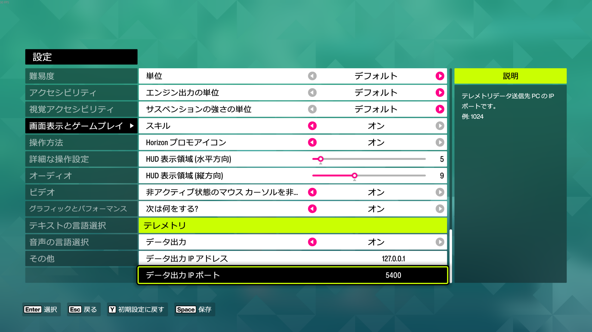

The names of the game's menus above are given for the English version of the game and may differ slightly; the screenshot shows the Japanese version.

If you want to change the port, set `UdpPort` in `appsettings.Local.json` to the same value. Avoid 5200–5300, which the game itself uses.

### Using it with SimHub and others (pass-through)

The game's Data Out can be sent to only one place. If you also use another telemetry app such as SimHub, point the game's Data Out to HEISO (5400),
and HEISO forwards the data it receives to that app unchanged (it keeps forwarding even when not recording).

1. In SimHub, check the port it uses to receive Forza data (the port you entered in the game's Data Out until now; use a different number from HEISO's 5400)
2. In `ForwardTo` in `appsettings.Local.json`, write the destination as `"host:port"` (you can write several)

```json
{
  "Recorder": {
    "UdpPort": 5400,
    "ForwardTo": [ "127.0.0.1:8000" ]
  }
}
```

3. When you start the Recorder, "Forwarding to 127.0.0.1:8000" appears in the telemetry area of its page. Check that SimHub receives the data

- If the destination app isn't running, HEISO's recording is not affected
- Forwarding to itself (port 5400 on the same PC) makes the data loop, so it can't be used (a warning is shown on the page)

## 7. Start and check

1. Start OBS
2. Start `HeisoRecorder\HeisoRecorder.exe`. A black window (the Recorder itself) opens, and the Recorder page appears in the browser on your PC
   - The first time, Windows Firewall asks for permission. Allow "Private networks" (so you can open the page from your smartphone)
3. Start the game and drive; the speed and car appear on the page. If **OBS connected** (OBS 接続済み) is shown, you're ready
4. To use the Recorder from your smartphone, scan the QR code on the page with a smartphone connected to the same Wi-Fi as the PC
   - If you use security software such as ESET, you may not be able to open it from the smartphone. Check the security software's log for blocks, and allow it if it is blocked

To quit the Recorder, press **Ctrl+C** in the black window (if it is recording, it stops the recording and closes the files before exiting; closing the window with × may not leave enough time to save).

To start the Player, run `HeisoPlayer\HeisoPlayer.exe`.

## 8. To export at 720p (ffmpeg)

With **Export** (書き出す) in the Player, you can shrink (re-encode) the video to 720p when making a package. The file becomes smaller and easier to share.
Re-encoding uses **ffmpeg**. It isn't included in HEISO, so install it as follows only if you use it (not needed if you only export at the original quality).

1. From the "release builds" on gyan.dev (https://www.gyan.dev/ffmpeg/builds/), which distributes Windows builds of ffmpeg, download `ffmpeg-release-essentials.zip`
   - You can also reach this page from the Windows section of the official ffmpeg website (https://ffmpeg.org/download.html)
   - No installation is needed (it is a portable version that works just by extracting it)
2. Right-click the zip → Properties → check "Unblock" → OK (same as in "2.")
3. Create a folder named `ffmpeg` inside the HEISO folder, and extract it there

```
C:\HEISO\
  HeisoRecorder\
  HeisoPlayer\
  ffmpeg\
    ffmpeg-<version>-essentials_build\
      bin\ffmpeg.exe
```

4. In the Player's **Settings** → **Export**, click **Check** (確かめる). When "ffmpeg found: …" and the usable encoders (whichever of NVIDIA, AMD, Intel and CPU work on this PC) are shown, you're ready

- If you extracted it somewhere else, set that folder (or `ffmpeg.exe`) in **Location** (場所) under **Settings** → **Export**. ffmpeg on the PATH is also found
- If a GPU encoder (NVIDIA NVENC, AMD AMF, Intel Quick Sync) is available, a 4-minute race finishes in tens of seconds. If none is available, the CPU is used (takes a few minutes)
- The ffmpeg license (the essentials build is GPL) belongs to ffmpeg. HEISO does not distribute ffmpeg

## Troubleshooting

| Symptom | What to check |
|---|---|
| ".NET is required" appears at startup | You are using the zip without the runtime. Switch to the zip with the runtime, or install the runtimes in "3.". The Recorder needs the ASP.NET Core Runtime, the Player the Desktop Runtime; both x64 |
| No speed is shown on the Recorder page | The game's Data Out is on, the IP is `127.0.0.1`, and the port is the same as `UdpPort` (default 5400). No other telemetry tool is using the same port |
| Stays **OBS not connected** (OBS 未接続) | OBS is running. The WebSocket server is enabled. If authentication is on, the password ("5.") |
| The game isn't in the recording (another scene was recorded) | In **Scene to record** in the Recorder, choose the HEISO scene (the one with Game Capture). If it is left as **OBS's current scene**, the scene selected in OBS is recorded ("Automatic switching to the HEISO scene" in "4.") |
| "(not created in OBS)" appears in the quality choices | You haven't created the profiles in "4.". You can still record with **OBS settings as they are** |
| `--setup-obs-profiles` says OBS is running | Close OBS completely (including the system tray) and try again |
| Can't open the page from a smartphone | The PC and the smartphone are on the same Wi-Fi. You allowed "Private networks" in the firewall. Security software isn't blocking it. Choose another candidate in **PC address** (PCのアドレス) on the PC page (a virtual LAN address may be listed first) |
| Playback stutters, the video freezes for a moment or stays frozen | Quit the game before playing. The game keeps drawing on the GPU even behind other windows, and competes with the Player's video (confirmed on 2026-09-28; it was fixed by closing the game) |
| "Shrink to 720p" can't be chosen when exporting | ffmpeg isn't found, or there is no usable encoder. Install it as in "8." and check the status with **Check** under **Settings** → **Export** |
| The Player crashes | The next time it starts, it tells you where the logs are (`%LOCALAPPDATA%\HEISO\Player\logs`). We would appreciate it if you report it in GitHub Issues with the logs |

## Uninstalling

- Delete the extracted folder (for example `C:\HEISO`)
- Player settings and logs: `%LOCALAPPDATA%\HEISO`
- Recorded data: "Videos\FH6Recorder" (or the folder you set in `OutputDir`). Delete it if you don't need it
- OBS profiles "HEISO …": delete them one by one with OBS's Profile → Remove

---

Forza Horizon 6 © Microsoft Corporation. HEISO was created under Microsoft's "[Game Content Usage Rules](https://www.xbox.com/en-US/developers/rules)" using assets from Forza Horizon 6, and it is not endorsed by or affiliated with Microsoft.
