# Using HEISO Solo

> **About this document:** This is a machine translation of the Japanese [usage.md](../usage.md). The screenshots and animations show the Japanese versions of the apps (and of the game), so the labels in the images are in Japanese. In the text, the English label shown by the app is followed by the Japanese label in parentheses where that helps you find it in a screenshot.
> If this translation and the Japanese original differ, the Japanese original is correct.

Installation and setup are described in [install.md](install.md).

1. In the Recorder, record the telemetry and the video while you drive
2. In the Player, watch the video and graphs side by side
3. Export a race you want to show as a package (`.heiso.zip`) and give it to others

## 1. Record (Recorder)

Start OBS, then start `HeisoRecorder.exe`. A black window (the Recorder itself) opens, and the Recorder page appears in the browser on your PC.
The black window shows the addresses to open on the PC and the smartphone, the port that receives telemetry, and where recordings are saved. When it connects to OBS, it says so.

To use it from a smartphone, scan the QR code on the PC page (on the same Wi-Fi as the PC). If you bookmark the page on the smartphone, you can open it directly next time.

### Starting and stopping a recording

1. Turn on **Record video with OBS** (OBSで録画する), and choose **Recording quality** (録画の画質) and **Scene to record** (録画するシーン) (to record only telemetry without video, turn it off)
2. Enter a note if you like (for example `Mecha My Day`). It is added to the end of the recording's folder name
3. Start recording with the round button. A **red** border means video and telemetry, **blue** means telemetry only
4. Drive. You can drive as many races in a row as you like without stopping (the Player tells the races apart)
5. To stop, press the round button and press it again within 3 seconds (two presses, so you don't stop by accident)

- **Add marker** (マーカーを打つ) puts a mark at that moment
- The lower the quality step, the smaller the file. If you plan to give packages to others, "Light" or "Medium" is recommended (about 200–300 MB for a 4-minute race). You can also record at higher quality and shrink to 720p with ffmpeg when exporting (the same 720p as "Light")
- Recordings are created in "Videos\FH6Recorder" (or the folder you set) as folders named by date and time, such as `20260928_153147`. To make it easier to tell races apart later, you may add a comment to the end of the folder name by hand (for example `20260928_153147#summer_Toriyama`)

### Scene to record (automatic switching in OBS)

**The Recorder switches OBS to the HEISO scene and profile only while recording, and switches back when recording ends.**
If you already use OBS for streaming or other things, you can keep your usual scenes and profiles and just add one HEISO scene (how to create it: "Create a scene for HEISO" in [install.md](install.md)).

1. Create a HEISO scene with Game Capture in OBS (for example `HEISO`)
2. Choose that scene in **Scene to record** in the Recorder. The description says: Switches OBS to the scene "HEISO" while recording, then back
3. Then just start and stop recording as usual. Even if another scene is selected in OBS, it switches to the HEISO scene while recording and back to the previous scene when you stop

| **Scene to record** | What is recorded |
|---|---|
| The HEISO scene (for example `HEISO`) | Always the HEISO scene. Switches no matter what is selected in OBS (**recommended**) |
| **OBS's current scene** (OBS で今選んでいるシーン) | The scene selected in OBS when recording starts. Nothing is switched |

- The chosen scene is used again next time. **Recording quality** (the OBS profile) is also switched only while recording and switched back the same way
- If the chosen scene doesn't exist in OBS (renamed or deleted), the current scene is recorded without switching, and the page tells you
- **Don't record while streaming.** The OBS scene changes while recording, so your stream also changes

### Car and course names

The telemetry doesn't include car or course names, so you name them in the Recorder. It watches the game even when not recording.

- **Car check**: appears when you change cars. For a new car, enter the car name. Even for the same car, if the PI or other values change with the setup, you can name the setup. Once a combination is registered, its name appears automatically next time
- **Course check**: appears when a race starts on a new course. Enter the race name and type. Next time, the course is recognized automatically by its start position
- You may close them with **Later** (あとで). You can name them after the race or after stopping the recording with **Fix course / car names** (コース名・車名を直す) under **Last race** (直前のレース). The names appear in the Player's list of races
- You can also name cars and courses with **Name it** (名前を付ける) in the Player (see "Choosing a race" below)

### Quitting

Press **Ctrl+C** in the Recorder's black window.

## 2. Watch (Player)

Start `HeisoPlayer.exe`, press **Open recording** (記録を開く) and choose a recording from the list (double-click a row, or press **Open**). The list shows the recordings in the Recorder's save folder, newest first. The first time, or for recordings elsewhere, use **Choose save folder…** or **Choose folder…** in the list.

### The recording list and the archive

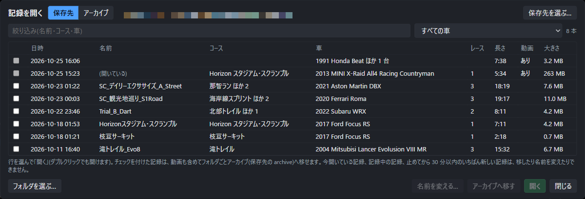

- The list shows the date, name, course, car, number of races, length, whether there is a video, and the size. Cars are listed by model (the same model counts once even with a different PI or class)
- Type in the box at the top to filter by name, course or car. The menu on the right filters by car model
- **Archive**: check recordings you are done with and press **Move to archive**. They are moved, folder and video included, to the `archive` folder in the save folder (on the same drive, so it is quick and uses no extra space). Switch to **Archive** at the top to open archived recordings or move them back with **Move back**
- **Rename**: select a recording and press **Rename…** to change the part of the folder name after the date and time (for example `20261018_020532` → `20261018_020532_StadiumScramble`). The names in measure mode's car profiles are updated too
- The open recording, a recording in progress, and the newest recording within 30 minutes of stopping cannot be moved or renamed (the Recorder may still add things such as the confirmed course after stopping)
- There is no way to delete recordings in the Player. Delete them in File Explorer

**If playback stutters, quit the game.** The game keeps drawing on the GPU even behind other windows, so the video freezes for a moment or stays frozen.

### The screen

- Top: the video. To the right are the controls and the course map, the values at the pointer position, and what was detected
- Bottom: the graphs. The X axis is the video position. The **yellow vertical line** is the current position
- Marks on the graphs: a light-blue ▼ is a start, a white ◇ is a lap start (filled: finish), an orange dotted line is a contact, a purple band is a jump, red is where you left the road and it led to a slip or a rewind, and a gray band is a section that can be skipped

When you play, the yellow line moves along with the video.

### Common controls

| Control | Action |
|---|---|
| Space | Play / pause |
| Mouse wheel over the graphs or video | Back/forward 1 second (1 frame while holding Shift) |
| `,` / `.` | Back/forward 1 frame |
| Ctrl+← / → | Back/forward 10 seconds (30 seconds with Ctrl+Alt) |
| Click a graph | Go to that moment |
| Drag a graph | Slides the graphs left or right. The playback line stays where it is, and the playback position moves by the amount you dragged (drag right to go back, left to go forward). Playback stops if it was playing |
| Shift+drag (over the graphs) | Zoom into the selected range. Double-click to show everything again |
| Click or drag the scale at the bottom (time / distance) | The playback line follows the mouse (drag right to go forward), like the time ruler in a video editor. The graphs do not move |
| Two-finger horizontal swipe on a touchpad | Slides the graphs like dragging them (swipe left to go forward) |
| Ctrl+wheel (over the graphs) | Zoom the graphs horizontally |
| **◀ Prev** / **Next ▶** | Go to the previous/next mark (3 seconds before a start, 1 second before a lap, etc.) |
| Click or drag the bar under the video | Go there. The bar is the whole video: blue is a race (the selected race is brighter), grey is outside races, white triangles are where **◀ Prev / Next ▶** stop, and the yellow line is now |
| **Rate** (速さ) | 0.25× / 0.5× / 1× |
| Click the course map | Go to the moment you passed that place |

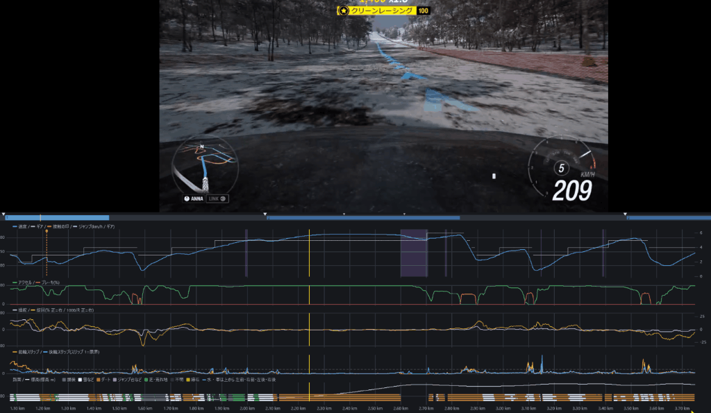

### Choosing a race

Use **Race** (レース) at the top to choose a race in the recording (the course and car names and whether it was likely finished or abandoned are shown).
Choosing one moves to 3 seconds before its start and sets the graphs to that race.

- With **Name it** (名前を付ける) you can name the race's course, car and setup, in case you forgot in the Recorder. The names are registered the next time the Recorder starts, and appear automatically from then on

  

- Setting **X axis** (横軸) to **Distance** (距離) lines up the graphs by distance from the start. Runs redone with rewind are left out, and the race is shown as the one run that made it to the finish
- With **Skip ON** (スキップ ON), playback skips redo sections (rewinds, missed checkpoints) and pauses (photo mode, menus)

### Course map

- Switch with **2D / 3D**. 3D has elevation, with **Top / Angled / Chase** (真上 / 斜め / 後ろから) views. You can rotate (left drag), move (right drag) and zoom (wheel) with the mouse
- Zooming in with **All / 2 km / 1 km / 500 m / 200 m** follows the current position. With **Sections** (区切り), the view moves section by section, split in the middle of straights (the map doesn't spin when you spin)
- **Surface** (路面の色) colors where you drove by road surface (paved, dirt, grass, etc.)

### Load transfer

Press **Load transfer** (荷重移動) to show, as one dot in the course map area, which way the load has moved front/rear and left/right. When you first use performance mode, this is what it shows (if you used an earlier version, it stays on the friction circle as before).

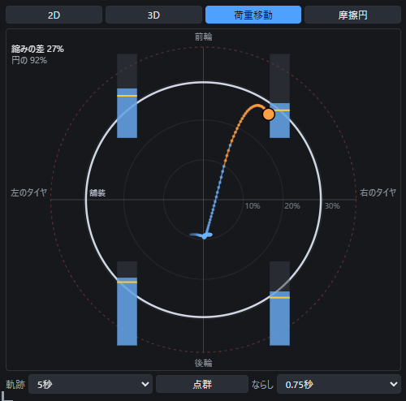

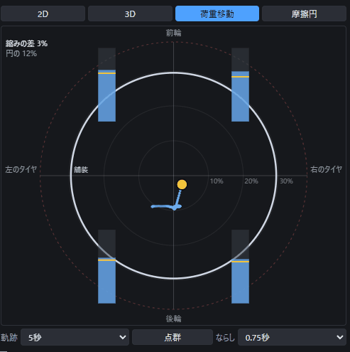

- The dot moves toward **the side where the suspension is compressed**: up (front tyres) under braking, down (rear tyres) under acceleration, left (the outside left tyres) in a right-hand corner
- Vertical is "front pair compression − rear pair", horizontal is "right pair − left pair", as a % of full travel (the scale is in %). Zero is set from the parts of the drive where you go straight at a steady speed (to remove the difference between front and rear springs)
- G appears the moment you press a pedal, but the suspension moves after the car settles. So you can see the delay between braking and the load reaching the front, how you release the brake (release it at once and the dot snaps back), and the car pitching and rolling
- The ring is **the largest difference this drive reached** on that surface (top 2%). Trail, Cloud and the orange dot (slip over the limit) work the same as on the friction circle
- **Smoothing** (ならし), to the right of Cloud, sets how many seconds either side the dot is averaged over (0.25 s / 0.5 s / 0.75 s / 1 s; shared with the friction circle). Wider removes more of the small jitter and makes the direction easier to follow, but short braking peaks come out lower. The front/rear and left/right load graphs use the same width
- The values at the pointer show the same numbers as "Load front / right" (front/rear: + = front compressed; left/right: + = right compressed)
- The four bars around the circle are **the suspension of each wheel**, laid out like the tyres seen from above (front wheels on top, left tyres on the left). Like a real spring, a bar gets shorter as load compresses it. The white line is its length when driving straight at a steady speed. The bars are always smoothed over 0.25 s either side, whatever **Smoothing** is set to, and a thin yellow line marks the most compressed point within that width (so a brief peak that smoothing lowers still shows). Red means nearly lifting (under 5%), orange means nearly fully compressed (over 95%); a bar turns that colour if it happens anywhere within the width. During a jump the dot disappears, all four bars turn red and stretch out, and "Airborne" appears at the top left. On landing all four briefly turn orange and short. This shows what the front/rear and left/right differences cannot, such as only the inside rear wheel lifting. The values are shown as "Travel front / rear"
- It is a guide, not the actual load on each tyre. Spring stiffness, downforce and bumps also change it. Nothing is shown while the car is in the air (any wheel fully extended)

#### Load transfer and the friction circle

Both show one dot in a circle, but they show different things.

| | Friction circle | Load transfer |
|---|---|---|
| What it shows | The force the tyres put on the car (G) | Which tyres carry the car's weight (how far the suspension is compressed) |
| Dot direction | The way the car is pushed: down under braking, right in a right-hand corner | The way your body is thrown: up (front) under braking, left (outside) in a right-hand corner |
| How fast it moves | As soon as you use the pedals or steering | After the car settles, a little later |
| What it tells you | Whether you are using all the tyres' grip | Whether you put weight on the tyres before you turn |

A tyre grips harder the more weight is on it. When braking makes the nose dip, weight moves onto the front tyres and the steering bites better. If you release the brake suddenly, the weight goes back to the rear, the front tyres get light and the car turns less. Load transfer shows where that weight is.

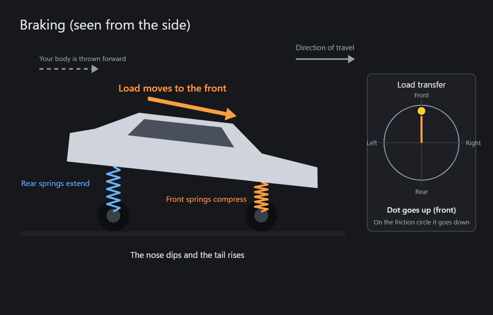

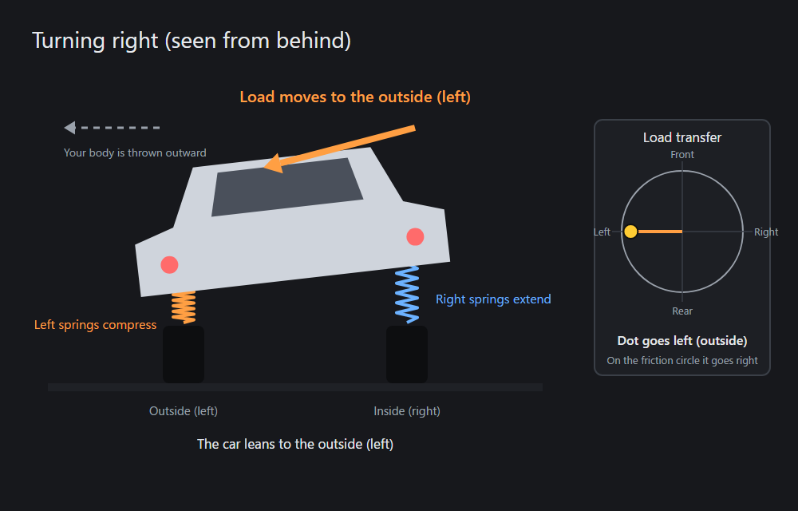

The friction circle dot moves as soon as you press a pedal. The load transfer dot moves a little later, after the car settles, and stays for a while after you release. The picture below is a real recording (braking in a right-hander): the load peaked about 0.2 s after the braking G. The graph preset **Load transfer** overlays longitudinal G and front/rear load so you can see this.

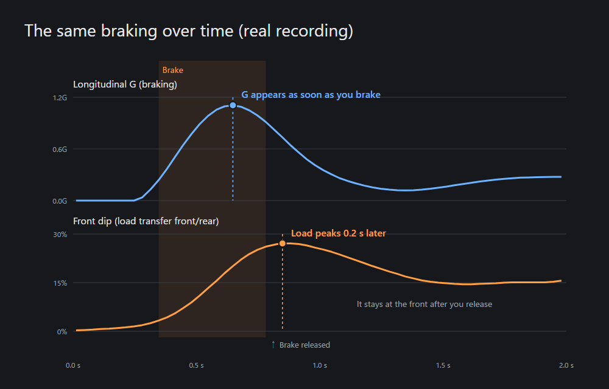

### Friction circle

Press **Friction circle** (摩擦円) to turn the course map area into a friction circle. It plots lateral G (right is positive) and longitudinal G (up is acceleration, down is braking) as a dot.

- The faint rings are the **largest combined G this drive reached** on each surface (paved, dirt, etc.), taken as the top 2% of the values. They are not the car's true limit. The closer the dot is to a ring, the more of the tires you are using
- The green dashed shape is **this car's limit** measured in measure mode (all recordings of the same car combined, for the surface you are on now). Left and right are the cornering limits, down is braking and up is launch; a quarter is drawn only when both of its directions are measured. When a race is selected, it uses the limit for that race's assists (ABS, TC, etc.). Nothing is drawn if nothing has been measured
- The dot turns orange when tire slip is over the limit (see the table below for all the colors)
- **Trail** (軌跡) draws the last few seconds as a line, and **Cloud** (点群) draws the whole run as faint dots
- The values at the pointer also show longitudinal / lateral G
- With a race selected, the rings are built from that race only
- The dot shows **the direction the car is being pushed**. It is the opposite of the way your body is thrown: right in a right-hand corner, down under braking
- Dots that fly far outside the rings (over 6G, for example) come from forces other than the tires, such as walls and landings. Even when the tires slide, the dot hardly goes past the edge of the ring

| Where | Control | What it does |
|---|---|---|
| Top | 2D / 3D / Load transfer (荷重移動) / Friction circle (摩擦円) | Switches what this area shows. The selected one is blue |
| Bottom left | **Trail** (軌跡, drop-down) | How many seconds of recent movement to leave behind the current dot (none / 1 s / 3 s / 5 s / 10 s) |
| Bottom | **Cloud** (点群) | Each press shows or hides the dots for the whole drive (blue while shown) |
| Bottom right | **Smoothing** (ならし, drop-down) | How many seconds either side the dot is averaged over (0.25 s / 0.5 s / 0.75 s / 1 s). Wider removes more of the small jitter, but short braking peaks come out lower. Shared with load transfer; the rings, cloud, trail and the friction circle % graph use the same width |

The colors of the dots, lines and rings mean:

| Color / shape | Meaning |
|---|---|
| Yellow dot | Now |
| Orange dot | Now, with tire slip over the limit (1) (the larger of the front and rear) |
| Red ring (hollow dot) | Outside the display limit (the red dotted ring). A hit from a wall, a landing, etc., drawn at the edge |
| Blue line | The trail (the last few seconds chosen in **Trail**). Older parts are fainter |
| Orange line | Parts of the trail where slip was over the limit |
| Faint dots | The cloud (all the acceleration in the selected race; turn it on or off with **Cloud**) |
| Solid white ring | The paved ring (the top 2% of combined G in this drive) |
| Dotted rings | Rings for other surfaces (dirt is brown, grass is green, snow etc. is white). The ring for the surface you are on is drawn thicker with its name |
| Red dotted ring | The display limit (1.3 times the largest ring) |

"Total … G" at the top left is the distance of the current dot from the center, and "…% of circle" is how far it is out toward the ring for the surface you are on (orange above 100%).

The two pictures below show how to read the dot. The orange arrow is the force the tires put on the car, and the dot on the friction circle points that way. The grey dashed arrow is the way your body is thrown (the opposite direction).

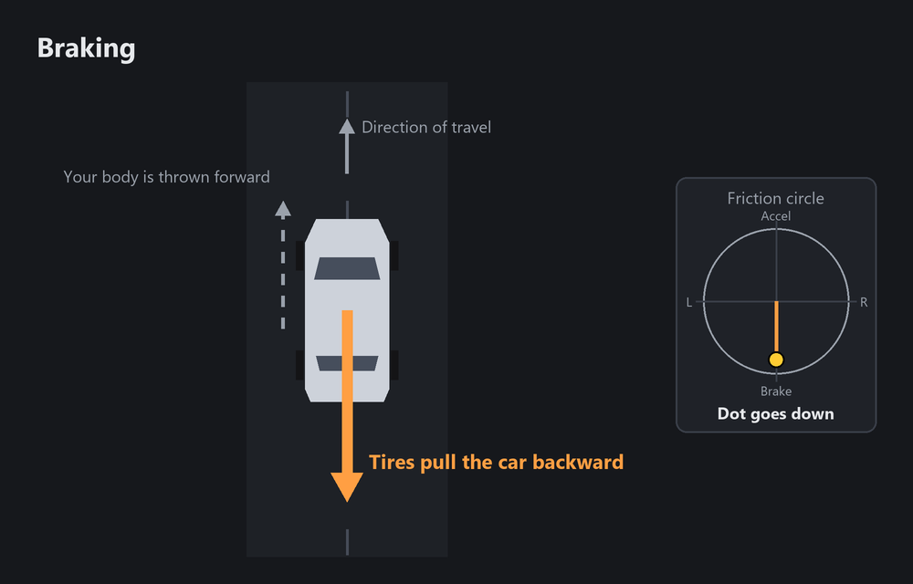

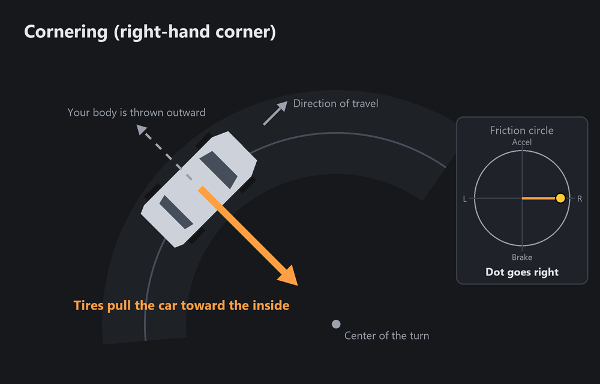

### Performance mode

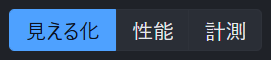

**Visualize / Performance** (見える化 / 性能) in the top bar switches the set of graphs. **Visualize** is the view you know (speed, pedals, steering, slip and the course map). **Performance** shows graphs for checking whether you are using the engine and tires fully. The set of graph rows and what the map area shows (2D, 3D, load transfer or friction circle) are remembered separately for each mode.

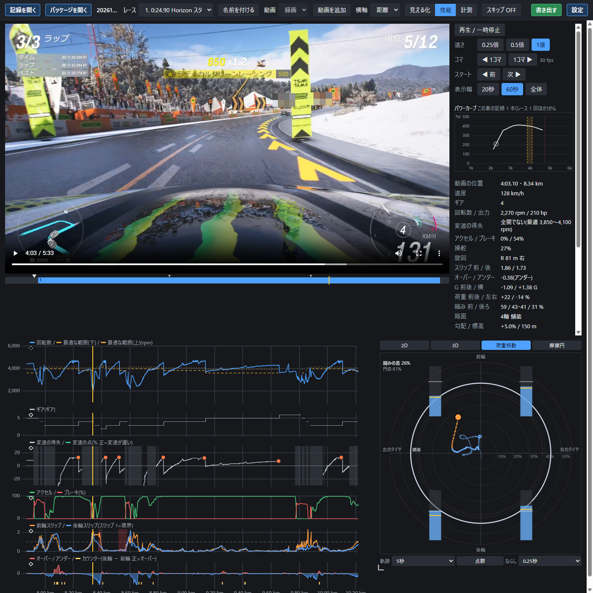

#### What you see

| Where | What it shows |
|---|---|
| RPM row | RPM and two dashed lines for the **best shift range** of the current gear (where the shift gain/loss is within ±3%). Shifting before the lower line leaves you with less power after the shift; shifting after the upper line means you held on while power was already dropping |
| Gear row | The current gear |
| Shift gain/loss row | The power difference if you shifted up right now (% of peak power). Above 0 means shifting would already be faster (you are late); below 0 means it is still too early. Where the throttle is not fully open, a grey band is shown and no value is given |
| Shift dots | Full-throttle upshifts: purple = early, green = on time (within ±3%), orange = late. Hover over a dot to see the shift RPM and the gain/loss. If you sat on the rev limiter before shifting, the time is shown too (e.g. "on the limiter for 0.8 s") |
| Over / understeer row | Rear slip angle minus front slip angle (1.0 is the limit for both). **Above 0 (red) is oversteer**: the rear tyres are sliding before the front. **Below 0 (blue) is understeer**: the front tyres go first. The yellow band at the bottom of the row is **countersteer**, where the steering points the opposite way to the car's rotation, so you can see where the rear stepped out and you were catching it. Not shown below 20 km/h |
| Right panel | **Load transfer** instead of the course map (switch to the friction circle with the buttons above it), with the **power curve** below it. On the power curve, ● is now (a grey ring means not full throttle) and ○ is where you would be if you shifted up right now. The shaded band and dashed lines are the best shift range; the red dotted line is the rev limiter |
| Values at the pointer | RPM / power, shift gain/loss (best … rpm), and the over / understeer value (labelled oversteer or understeer beyond ±0.3, and countersteer while it lasts) |
| Found (見つけたもの) | The number of full-throttle shifts and how they split into early / on time / late |

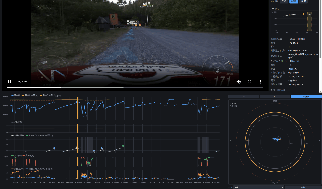

On the power curve alone, it moves like this. Shifting up from 1st gear right after the start, ● moves to the right and drops back to around ○ at each shift. During a jump the tyres spin freely, so ● sticks to the rev limiter (the right end).

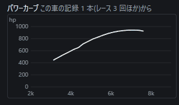

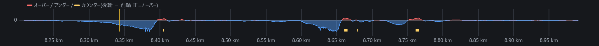

#### How it judges

- The power curve, gear ratios and rev limiter are built per car (car model and PI) from the car profile in measure mode (all recordings of the same car combined). The power curve heading shows "from N recordings of this car (M races and more)" (one recording can contain several races, so both counts are shown; "and more" means driving outside races is included too). If the profile has no curve yet, they are built only from the full-throttle driving in the recording you opened ("from this recording"). The limiter is taken from the RPM actually reached at full throttle, not from the maximum RPM the game reports (`engine_max_rpm`)
- **Shifts within 250 rpm of the limiter are never "early".** The engine can't rev any higher and power is cut at the limiter, so shifting there is the best you can do. The gain/loss is also shown as 0 while you sit on the limiter
- For cars where it pays to rev to the limiter in every gear (cars that drop a lot of RPM on each shift), the best range is a narrow band just below the limiter. Cars with flat power, such as EVs, have a wide range
- Automatic transmission and AutoDrive shift at the same RPM in every gear, so such races are marked "looks like automatic shifting" and their shift dots are drawn as hollow rings (the game is shifting, so they are for reference, not a judgement of your driving). Manual driving that shifts on the limiter is not treated as automatic, even though the shift RPM is the same every time

#### When there is no gain/loss

The values at the pointer show the reason under shift gain/loss.

| Message | Meaning |
|---|---|
| Not full throttle | Gain/loss is only worked out at full throttle |
| No higher gear used (if this is the top gear, there is no shift to judge) | The next gear was never used in this recording. If this is the top gear, there is nothing to shift into. The number of gears is not in the telemetry, so the app can't tell which it is |
| Unavailable (not enough full-throttle data in the next gear) | The next gear was used, but not at full throttle long enough to measure its ratio |
| Unavailable (… rpm after the shift is outside the power curve) | You haven't driven at full throttle around the RPM you would land on after the shift |
| Unavailable (no power curve) | There is too little full-throttle driving in the recording to build a power curve |

#### Tips for reading it

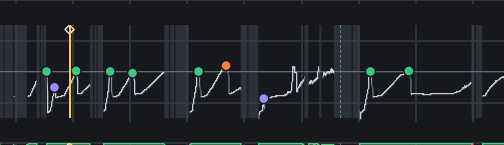

- **Lots of orange (late)**: you are hitting the limiter or holding on until power drops. Shift inside the best range
- **Lots of purple (early)**: you are shifting before the lower line. Hold on a little longer
- **Uphill, the car feels slow after shifting**: on cars that lose power on each shift, it shows most on hills. It is still faster than sitting on the limiter, so shift at the limiter. If you are about to brake, stay in gear instead
- **A big drop in power after shifting, even at the limiter**: this is the gearing (tuning), not your driving. Closer gear ratios or a shorter final drive keep you near the power peak after the shift

### Measure mode

**Measure** (計測) in the **Visualize / Performance / Measure** switch in the top bar shows **this car's profile** in place of the graphs.
The profile combines every recording of the same car (same model, class, PI, drivetrain and cylinders): power curve, gear ratios, rev limiter, top speed, and braking and cornering limits. Each time you open a recording, its driving is added (opening the same recording again does not add it twice). The braking, cornering and launch limits use only driving during races (driving outside races, such as moving around or AutoDrive, does not push the car to the limit and would make the limits too low).

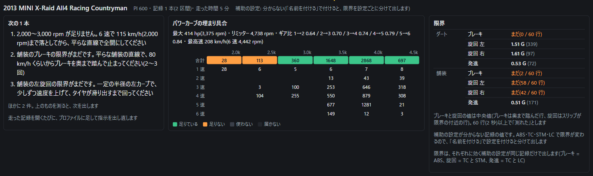

| Section | What it shows |
|---|---|
| Next run | How to drive to measure what is missing (the top 3 when there are many). For example: "Not enough data at 3,000–4,500 rpm. In gear 4, slow to 85 km/h (3,000 rpm), then go full throttle on a flat straight" |
| Power curve coverage | Max power, limiter, gear ratios and top speed, and the state of each 500 rpm band (green = enough, orange = not enough, grey = not used, black = unreachable). Below are the rows per gear |
| Limits | Braking (also per speed), cornering left and right, and launch, per road surface. Values with fewer than 60 rows (2 s) show as "Not yet" |

- **Unused RPM**: RPM below where you land after the biggest drop (the 1st→2nd shift) is not used in driving, so it doesn't need to be filled
- **Assists**: ABS, traction control and the other assists change the braking, cornering and launch limits, so the limits are shown separately for each race's assist settings (the power curve and gear ratios are not split). Assists are not in the telemetry, so set them per race under **Assists** in **Name** (名前を付ける) in the top bar: ABS, TC (traction control), STM (stability management) and LC (launch control) on / off, and shifting (AT / manual). Each limit uses only races with the same settings for the assists that affect it (braking = ABS, cornering = TC and STM, launch = TC and LC). Races without them set are grouped as "unknown"
- For a new car, first drive one normal run. Once the gear ratios are known, the advice from the second run on tells you which gear and what speed to use
- Profiles are stored on this PC in `%LOCALAPPDATA%\HEISO\Player\profiles`. Nothing is written to your recording folders. If you delete them, they are rebuilt when you open the recordings again

### Settings

**Settings** (設定) at the top right lets you change the following. The same settings are used for every recording you open (changes take effect immediately). Each item is also explained in the settings screen.

| Tab | What you can do |
|---|---|
| **Graphs** (グラフ) | The rows of graphs (speed, pedals, steering, slip, surface, elevation, etc.). Choose a preset, or drag the tags to rearrange them and save as your own layout. Whether to show contact and launch marks |
| **Display** (画面) | Display language (日本語 / English), units (km/h or mph, m or ft, etc.), what to show when a recording opens (all or per race, time or distance), where to put the course map and its size, whether to remember the window size |
| **Playback** (再生) | Start playing from 3 seconds before the first race's start when a recording opens; skip redo sections and pauses automatically |
| **Export** (書き出し) | The ffmpeg location and encoder for exporting at 720p ("8." in [install.md](install.md)) |
| **Sync** (同期) | The method for aligning the video and graphs (for checking; normally don't change it), and the replay video shift |

#### Graphs

**Rows of graphs**: decide how many rows the graphs at the bottom have, and what is drawn in each row.

| Item | Description |
|---|---|
| **Preset** (プリセット) | Choose a fixed combination: **3 rows** (start with this), **2 rows**, **4 rows (classic)**, **Detailed** (6 rows: speed and gear, pedals, steering and turning, slip, surface, elevation), **Load transfer** (5 rows, including longitudinal G with front/rear load and lateral G with left/right load overlaid; **Performance (load transfer)** in performance mode, which also has a friction circle % row). **My layout** is the combination you saved |
| **Save as my layout** (自分の設定として保存) | Remembers the current combination as **My layout**. You can always go back to it even after choosing another preset |
| Row height | **Large / Medium / Small** at the left of each row changes the row's height |
| Tags (speed, gear, etc.) | What is drawn in a row. Drag a tag to move it to another row. × removes it, **+ Add** adds one |
| ▲ ▼ / **Delete** / **+ Add row** | Reorder rows, delete a row, add a row |

What can be drawn: speed, gear, throttle, brake, steering, turning, front slip, rear slip, over / understeer, countersteer marks, longitudinal G, lateral G, front/rear load, left/right load, friction circle %, grade, elevation, surface (bands for the 4 wheels), contact marks, jumps. Front/rear and left/right load are the same values (%) as the load transfer view, signed like G so they can share a row with it (front/rear: + = rear compressed; left/right: + = left compressed). You can see G move first and the load arrive, and leave, later. Friction circle % is the same value as "% of circle" at the top left of the friction circle (combined G ÷ the circle for that surface); 100% is the most this drive reached. If it stays at 90–100% through a corner, you are using all the grip. The **Detailed** preset adds countersteer marks to the steering row and an over / understeer row.
In a row, the first unit has its scale on the left and the second on the right. Changes appear in the graphs immediately and are used the next time too.

**Marks**

| Item | Description |
|---|---|
| **Show possible contacts** (接触の候補の印を出す) | Shows orange dotted marks where you seem to have hit a wall or a car. Turn it off if there are too many |
| Also mark launches outside races (レース以外の発進も印にする) | Marks launches outside races too (traffic lights, etc.), and **◀ Prev / Next ▶** stops at them. Useful for reviewing free-roam practice |

#### Display

| Item | Description |
|---|---|
| **Language** (言語) | **Auto** is Japanese if the Windows display language is Japanese, otherwise English. You can also fix it to 日本語 or English. Changing it reloads the screen (the open recording and the playback position stay) |
| **Units** (単位) | Choose speed (km/h, mph), distance (m and km / ft and mi) and elevation (m / ft) separately. **Auto** uses miles if the Windows region is the US or the UK, otherwise meters. Only the display changes; the recorded data does not |
| **When a recording opens** (記録を開いたときの表示) | When a recording opens, whether to show all of it or per race (selecting the first race), and whether the X axis is time or distance. After opening, you can switch at any time with **Race** and **X axis** at the top |
| **Course map** (コース図) | Where to put it: **Right panel (next to the video)** or **Next to the graphs (bottom right)**. Next to the graphs, you can also set its size (width and height). 0 means a square matching the graph height (up to the visible height and 35% of the width, so it does not get too big with presets that have many rows). You can also drag the bottom-left corner of the course map |
| **Window** (ウィンドウ) | Remembers the window size and position (including maximized) and restores them next time |

#### Playback

| Item | Description |
|---|---|
| When a recording opens, play from 3 s before the first race start | Starts playing right before the race as soon as a recording opens |
| Automatically skip redo sections and pauses | Turns **Skip** at the top ON when a recording opens. Playback skips redo sections (rewinds, missed checkpoints) and pauses for photo mode and menus (gray bands in the graphs) |

#### Export

| Item | Description |
|---|---|
| **Location** (場所) | Where ffmpeg is. If empty, it is searched for automatically (the PATH, and an `ffmpeg` folder inside the HEISO folder). Choose with **Browse** (参照); **Check** (確かめる) shows the ffmpeg found and the usable encoders |
| **Encoder** (変換) | The encoder for shrinking to 720p. **Auto** picks what works on this PC in the order NVIDIA → AMD → Intel → CPU. The CPU is slow, so use a GPU if available |

How to install ffmpeg is in "8." of [install.md](install.md). If you only export at the original quality, no settings are needed here.

#### Sync

The method for aligning the video and graphs. It is for checking, so **normally leave it at "Recording-start event"** (録画開始イベント).
If the video and graphs look out of sync, don't change this; use **Manual sync** (同期の手動補正) in the right panel (see "If the video and graphs are out of sync" below).

**Shift when a replay is assigned** (リプレイを割り当てたときのずらし量): when a replay is newly assigned, the video is moved earlier by this amount with **Fine sync adjustment** (frames of that video; at 30 fps, 1 frame = 33.3 ms). The default is 5 frames (167 ms at 30 fps), the amount matched on an actual replay by comparing the brake lights and gear-shift sounds with the graphs.
When you **Use** an automatically found replay, or align one with **This frame = replay start** / **= Finish**, it starts shifted by this amount, and the Fine sync adjustment window shows "Video shifted 5 frames (167 ms) earlier". Replays already assigned don't change.
If every replay looks off in the same direction, change this (increase it if the brake lights in the video are already on at the start of braking on the graph; decrease it if they are not on yet). **Reset to default** (既定に戻す) sets it back to 5 frames.
Both the video and the telemetry change only once per frame (about 33 ms at 30 fps), so shifting by less than that makes almost no visible difference.

### If the video and graphs are out of sync

They are normally in sync, but if they look slightly off, you can align them with **Manual sync** (同期の手動補正) in the right panel.

1. Stop at a frame where a moment is clear, such as a landing impact or the start, and click **Use this frame** (このコマを使う)
2. Click **Pick on graph** (グラフで指す), and click the same moment on the graph
3. Click **Save** (保存). It stays aligned the next time you open it

### Watching a replay or a separately recorded video

Besides the recording, you can assign **the game's replay recorded after a race** or **a separately recorded video** (Game Bar, etc.) to a race, and watch it with the same graphs and course map.
Switch between the recording and assigned videos with **Video** (動画) at the top. The same moment is shown when you switch.

- In a replay, the parts redone with rewind are gone, and only the run that remained to the finish plays. While you watch a replay, the graphs also show only that run (there are no sections to skip)
- To record a replay, keep recording after the race's finish, and play the replay from the results screen **with the chase camera, at normal speed, to the end** (don't pause or fast-forward)

**Assigning the replay in the recording**

1. Choose a race with **Race** at the top, then **Add video** (動画を追加) → **Find the replay in the recording** (録画の中のリプレイを自動で探す). ffmpeg is needed ("8." in [install.md](install.md)). Every finished race in the recording is searched, so it doesn't matter which race is selected

   

2. While searching, the progress is shown at the bottom of the screen. It takes tens of seconds per race (you can cancel with **Stop** (中止))

   

3. The result is shown for each race. A replay is searched for only between a race's finish and the start of the next race (so even if you drove the same course several times and recorded the replay at the end, you can tell which race it belongs to). For a race where it was found, the video time where the replay starts and the confidence (high or low) are shown. Click **Use** (採用), and **Video** at the top switches to the replay

   

4. If the confidence is low, or nothing was found, click **Match race N manually** (○ レース目に手動で合わせる; the race selected in **Race** at the top). At the first frame of the replay click **This frame = replay start** (いまのコマ = リプレイの先頭), or at the moment of the finish (just before the screen goes black) click **= Finish** (= ゴール)

**Assigning a separately recorded video**

1. Choose a race with **Race** at the top, then **Add video** → **Choose a video of the live run…** (ライブ走行の動画を選ぶ…; a video of you driving) or **Choose a replay video…** (リプレイの動画を選ぶ…; a video of only the replay)
2. For a video of the live run, align one point with **Manual sync** in the right panel (the same steps as in "If the video and graphs are out of sync" above). For a replay video, align it with **This frame = replay start**
3. If the video's frame spacing isn't constant (variable frame rate), the timing can drift little by little. If a warning appears, check that it still matches near the finish

**Fine adjustment (Fine sync adjustment)**

While you watch an assigned video, a small **Fine sync adjustment** (同期の微調整) window appears over the video (you can drag it). The graph stays put; you step the video frames back or forward to match.
When a replay is newly assigned, this window opens with the video already moved earlier by the **Shift when a replay is assigned** setting ("Video shifted 5 frames (167 ms) earlier"). The window shows the current shift of that video.

1. With **Graph** (グラフを) **Brake ▶** (ブレーキ ▶), put the graph (the yellow line) at the start of braking (**Shift ▶** (変速 ▶) for the moment of a gear shift).
   In the example below, the graph is at the start of braking, but the brake lights are already on in the video. The video is slightly ahead

   

2. With **Video** (映像を) **◀ 1 frame / 1 frame ▶** (◀ 1コマ / 1コマ ▶), step only the video one frame at a time (keys `[` `]`; 0.1 s while holding Shift). The yellow line on the graph doesn't move.
   Step back to the frame where the brake lights go off: the lights come on in the next frame, which is the same moment as the start of braking on the graph. The amount shifted is shown at the bottom of the window (133 ms earlier in this example)

   

3. Play from a little before; when the brake lights and the shift sounds match the graph, you're done. The shift is saved immediately

Assignments are saved in the recording (`session.json`), and appear in **Video** the next time you open it. If you move a video and it can no longer be found, choose it again with **Choose video again…** (動画を選び直す…) under **This video** (この動画) in the right panel. **Unassign** (割り当てを外す) removes an assignment (the video file is not deleted).

If you assigned a video to the wrong race, or no longer need it, choose that video with **Video** at the top, click **Unassign** under **This video** in the right panel, and click "OK" in the confirmation dialog. After unassigning, **Video** at the top goes back to the recording.

## 3. Share (distribution package)

### Exporting

1. Open a recording in the Player and choose the race to export with **Race** at the top
2. Click the green **Export** (書き出す) at the top right and choose how to export
   - **Original quality** (元の画質のまま): cuts without re-encoding. The quality is as recorded, and it takes a few seconds
   - **Shrink to 720p** (720p に縮める): re-encodes with ffmpeg. The file becomes smaller (around 140 MB for a 4-minute race) and easier to share. It takes tens of seconds with a GPU, or a few minutes with the CPU only. ffmpeg is needed ("8." in [install.md](install.md))
3. Choose where to save with **Choose where to save and export** (保存先を選んで書き出す), and a `.heiso.zip` is created. For 720p, the progress is shown at the bottom of the screen (you can cancel with **Stop**)

- The video runs from 5 seconds before the race's start to 5 seconds after the finish (the ranking screen after the finish is not included)
- The package contains the video, the telemetry for the same range, the course and car names, the race time and more. The note you entered in the Recorder is also included
- You can't export from a recording made without video, or from a recording that is still in progress
- If a replay or a separately recorded video is selected in **Video** at the top, **that video** is exported. For a replay, the package contains the video from the start of the replay to the finish (where the screen goes black), and the telemetry of the run that remained to the finish. When exporting at the original quality, the start may be about 1 second late (the first part of a replay overlaps with a screen transition, so none of the driving is lost)
- **No audio** (音声を入れない) makes a video without sound (when you don't want the music in it)

### Opening a package you received

Choose the `.heiso.zip` with **Open package** (パッケージを開く) in the Player. You don't need to extract it. It plays just like a recording.

### Notes on sharing

- Packages contain game footage. Share them within Microsoft's "Game Content Usage Rules" (non-commercially)
- **If you record with the intention of sharing, we recommend turning on the game's "Streamer Mode".** In the game, Settings → Audio → Streamer Mode. The game describes it as enabling live streaming of the in-game music, switching to music suitable for streaming and sharing.
  Set it before recording (the music in videos already recorded doesn't change). To share a video recorded without it, use **No audio** when exporting

  

- While driving, other players' names appear above their cars. HEISO can't remove them automatically, so if you mind, blur them with video-editing software.
  **Other players' names don't appear in the game's replay.** To share, we recommend assigning the replay and exporting it (see "Watching a replay or a separately recorded video" above)
- An easy way to share a package is to put the file on Google Drive, OneDrive or similar and share a link

## Known limitations

- Only Forza Horizon 6 (PC) and Windows are supported
- OBS Studio is required for recording
- The game sends telemetry about 30–60 times per second (depending on the game's fps)
- Whether a race was finished or abandoned is estimated from the telemetry
- Comparing two runs on the same course side by side ("HEISO") will come in a later version

---

Forza Horizon 6 © Microsoft Corporation. HEISO was created under Microsoft's "[Game Content Usage Rules](https://www.xbox.com/en-US/developers/rules)" using assets from Forza Horizon 6, and it is not endorsed by or affiliated with Microsoft.
