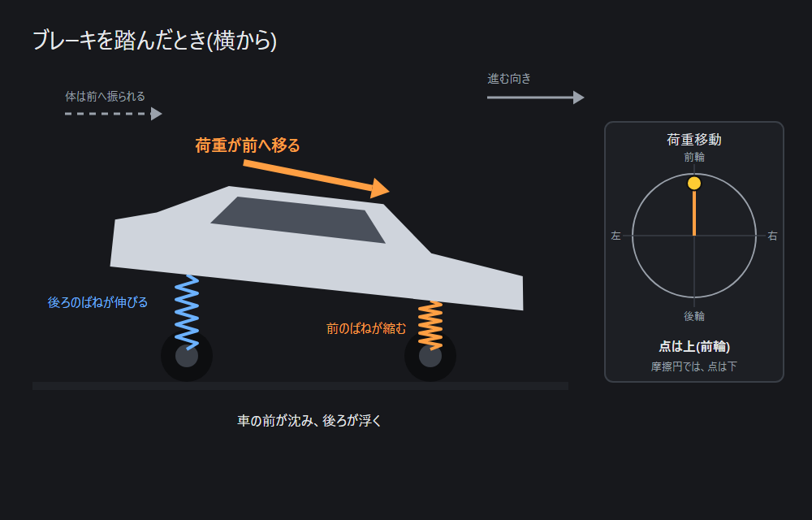
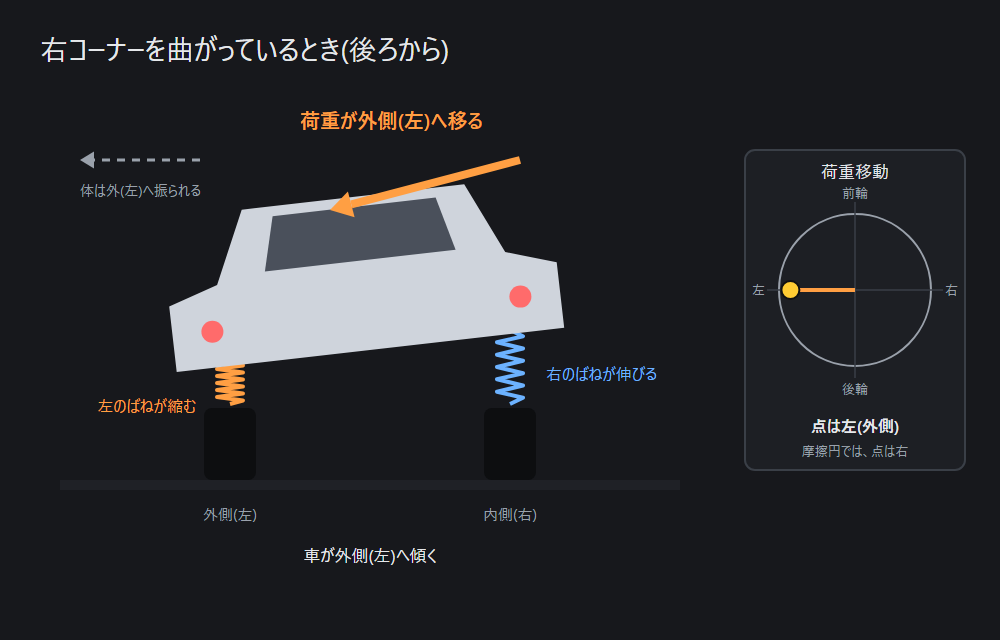
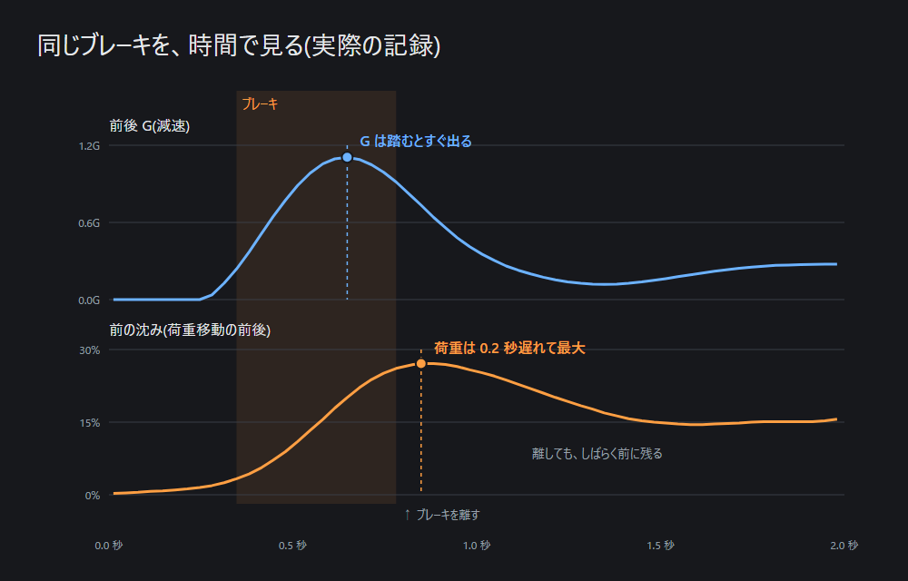
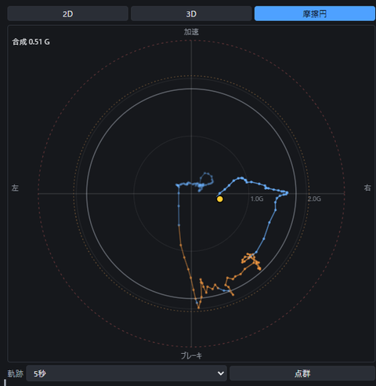
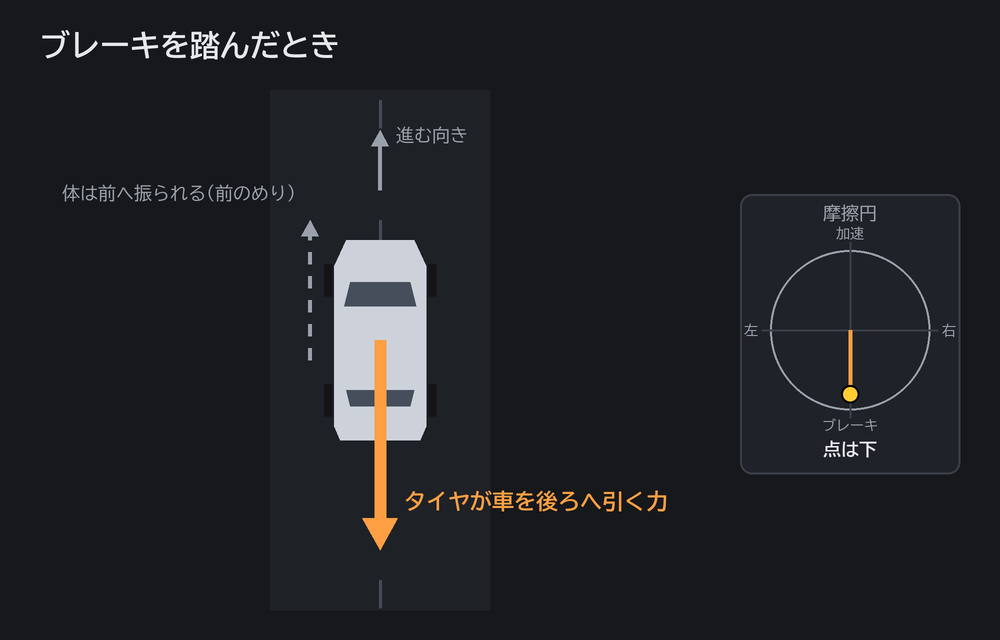
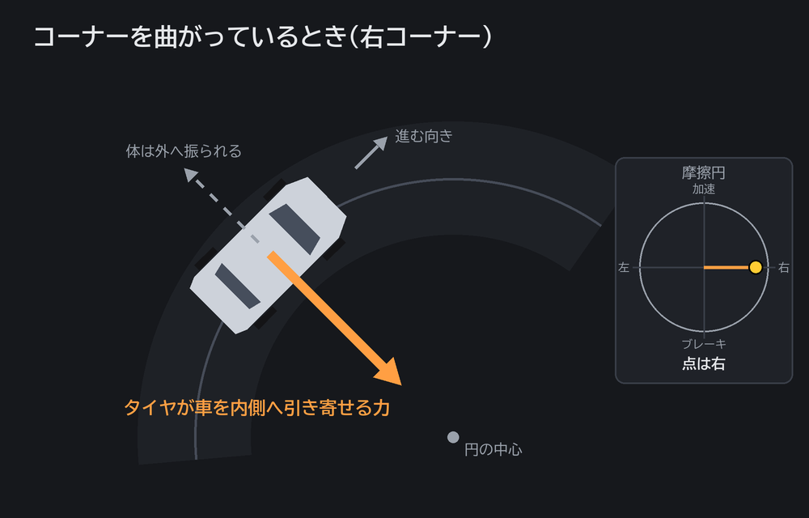

# HEISO 単走版 の使い方

インストールと設定は [install.md](install.md) にあります。

English (machine-translated): [en/usage.md](en/usage.md)

1. 記録アプリで、走りながらテレメトリーと録画を記録する
2. 再生アプリで、動画とグラフを並べて見る
3. 見せたいレースを 1 本、パッケージ(`.heiso.zip`)に書き出して人に渡す

## 1. 記録する(記録アプリ)

OBS を起動してから `HeisoRecorder.exe` を起動します。黒い窓(記録アプリの本体)が開き、PC のブラウザに記録アプリの画面が出ます。
黒い窓には、PC とスマホで開くアドレス、テレメトリーを受けるポート、保存先が出ます。OBS につながると「OBS に接続しました」と出ます。

スマホで使うなら、PC の画面の QR コードを読みます(PC と同じ Wi-Fi で)。スマホの画面は、ブックマークしておけば次からもそのまま開けます。

### 記録の始め方と止め方

1. 「OBSで録画する」がオンで、「録画の画質」と「録画するシーン」を選ぶ(録画しないでテレメトリーだけ記録するなら、オフにする)
2. 必要ならメモを入れる(例: `メカ・マイ・デイ`)。記録のフォルダ名の後ろに付きます
3. 丸いボタンで記録を始める。画面のふちが**赤**なら録画とテレメトリー、**青**ならテレメトリーだけ
4. 走る。記録を止めずに、何本続けて走ってもかまいません(再生アプリがレースを 1 本ずつ見分けます)
5. 止めるときは丸いボタンを押し、3 秒以内にもう一度押す(うっかり止めないように 2 回押します)

- 「マーカーを打つ」で、その時刻に印を付けられます
- 録画の画質は、段階が小さいほどファイルが小さくなります。人にパッケージを渡すつもりなら「軽量」か「中間」がおすすめです(4 分のレースで 200〜300MB くらい)。高い画質で録って、書き出すときに ffmpeg で 720p に縮めることもできます(「軽量」と同じ 720p になります)
- 記録は「ビデオ\FH6Recorder」(または設定した保存先)に、`20260928_153147` のような日時のフォルダで作られます。後からどのレースか分かりやすくしたいときは、フォルダ名の後ろに手でコメントを足してもかまいません(例: `20260928_153147#夏_鳥野山`)

### 録画するシーン(OBS の自動の切り替え)

**記録アプリは、録画の間だけ OBS を HEISO 用のシーンとプロファイルに切り替え、録画が終わったら元に戻します。**
配信などで OBS をすでに使っている人も、普段のシーンやプロファイルはそのままで、HEISO 用のシーンを 1 つ足すだけで使えます(作り方は [install.md](install.md) の「HEISO 用のシーンを作る」)。

1. OBS に、ゲームキャプチャを入れた HEISO 用のシーン(例: `HEISO`)を作っておく
2. 記録アプリの「**録画するシーン**」で、そのシーンを選ぶ。説明に「録画の間だけ OBS のシーンを「HEISO」に切り替え、終わったら元に戻します」と出ます
3. あとは普段どおり記録を始めて止めるだけです。OBS で別のシーンを選んでいても、録画の間は HEISO 用のシーンに切り替わり、止めると元のシーンに戻ります

| 「録画するシーン」 | 録画されるもの |
|---|---|
| HEISO 用のシーン(例: `HEISO`) | いつも HEISO 用のシーン。OBS で何を選んでいても切り替える(**おすすめ**) |
| OBS で今選んでいるシーン | 記録を始めたときに OBS で選んでいるシーン。切り替えない |

- 選んだシーンは次の起動でも使います。「録画の画質」(OBS のプロファイル)も同じように、録画の間だけ切り替えて元に戻します
- 選んだシーンが OBS に無い(名前を変えた・消した)ときは、切り替えずに今のシーンで録画し、画面に知らせます
- **配信しながら記録しないでください。** 録画の間は OBS のシーンが切り替わるので、配信の画面も変わります

### 車とコースの名前

テレメトリーには車やコースの名前が入っていないので、記録アプリで名前を付けます。記録していないときも、ゲームの様子を見ています。

- **車の確認**: 乗り換えると出ます。初めての車なら車名を入れます。同じ車でもセッティングで PI などが変われば、セッティング名を付けられます。一度登録した組み合わせは、次から自動で名前が出ます
- **コースの確認**: 初めてのコースでレースが始まると出ます。レース名と種類を入れます。次からはスタートの位置で自動で見分けます
- 「あとで」で閉じてもかまいません。「直前のレース」の「コース名・車名を直す」で、レースの後や記録を止めた後でも付けられます。付けた名前は、再生アプリのレースの一覧に出ます
- 再生アプリの「名前を付ける」でも、車とコースの名前を付けられます(下の「レースを選ぶ」)

### 終わるとき

記録アプリの黒い窓で **Ctrl+C** を押します。

## 2. 見る(再生アプリ)

`HeisoPlayer.exe` を起動し、「記録を開く」で記録の一覧から選びます(行をダブルクリックか「開く」)。一覧に出るのは記録アプリの保存先の記録で、新しい順です。初めてのときや、ほかの場所の記録は、一覧の「保存先を選ぶ…」か「フォルダを選ぶ…」で選びます。

### 記録の一覧とアーカイブ

- 一覧には、日時・名前・コース・車・レースの数・長さ・動画の有無・大きさが出ます。車は車種ごとです(PI やクラスが違っても、同じ車種なら 1 つ)
- 上の欄に文字を入れると、名前・コース・車で絞り込めます。右の選択で、車種でも絞り込めます
- **アーカイブ**: 使い終わった記録にチェックを付けて「アーカイブへ移す」を押すと、動画も含めてフォルダごと、保存先の中の `archive` フォルダへ移します(同じドライブの中なので、すぐ終わります。容量は変わりません)。上の「アーカイブ」に切り替えると、アーカイブの記録を開いたり、「保存先へ戻す」で戻したりできます
- **名前を変える**: 記録を選んで「名前を変える…」で、フォルダ名の日時より後ろを変えられます(例: `20261018_020532` → `20261018_020532_スタジアム・スクランブル`)。計測モードの車のプロファイルの中の名前も、一緒に直します
- 今開いている記録、記録中の記録、止めてから 30 分以内のいちばん新しい記録は、移したり名前を変えたりできません(記録アプリが、止めた後もコースの確定などを追記するため)
- 記録を消す機能はありません。消すときはエクスプローラーで消してください

**再生がカクつく場合は、ゲームを終了してください。** ゲームは画面の後ろに回っても GPU で描き続けるので、動画が一瞬ずつ止まったり、止まったままになったりします。

### 画面

- 上: 動画。右に操作とコース図、ポインターの位置の値、見つけたもの
- 下: グラフ。横軸は動画の位置。**黄色の縦線**が今の位置です
- グラフの印: 水色の ▼ がスタート、白い ◇ が周回のスタート(塗りはゴール)、橙の点線が接触、紫の帯がジャンプ、赤がコースを外れてスリップやリワインドにつながった所、灰色の帯がスキップできる区間

再生すると、黄色の縦線が動画に合わせて進みます。

### よく使う操作

| 操作 | 動き |
|---|---|
| Space | 再生・一時停止 |
| グラフや動画の上でホイール | 1 秒ずつ前後に(Shift を押しながらなら 1 コマ) |
| `,` / `.` | 1 コマ戻る・進む |
| Ctrl+← / → | 10 秒前後に(Ctrl+Alt なら 30 秒) |
| グラフをクリック | その瞬間へ |
| グラフをドラッグ | グラフを左右にずらします。再生位置の線は止まったままで、ずらした分だけ再生位置が動きます(右へずらすと戻る、左へずらすと進む)。再生中なら止まります |
| Shift+ドラッグ(グラフの上) | 選んだ範囲を拡大。ダブルクリックで全体に戻す |
| いちばん下の目盛り(時間・距離)をクリック・ドラッグ | 線がマウスについて動きます(右へ動かすと進む)。編集ソフトの時間の目盛りと同じです。グラフはずれません |
| タッチパッドで横に 2 本指 | グラフのドラッグと同じく、グラフをずらします(指を左へ動かすと進む) |
| Ctrl+ホイール(グラフの上) | グラフの横の拡大・縮小 |
| 「◀ 前」「次 ▶」 | 前後の印(スタートの 3 秒前、周回の 1 秒前など)へ |
| 動画の下の帯をクリック・ドラッグ | その位置へ。帯は動画の全体で、青がレース(選んでいるレースは明るく)、灰色がレースの外、白の三角が「◀ 前 / 次 ▶」で止まる所、黄色の線が今です |
| 速さ | 0.25 / 0.5 / 1 倍 |
| コース図をクリック | その場所を通った瞬間へ |

### レースを選ぶ

上の「レース」で、記録の中のレースを選べます(コース名・車名と、完走したか中断したかの推定が出ます)。
選ぶとスタートの 3 秒前へ移り、グラフをそのレースの範囲にします。

- **「名前を付ける」**で、そのレースのコース名・車名・セッティング名を付けられます。記録アプリで付け忘れたときに。付けた名前は、次に記録アプリを起動したときに登録され、次からは自動で出ます

  

- **横軸を「距離」にする**と、スタートからの距離でグラフを並べます。リワインドでやり直した走りは除いて、最後まで走り切った 1 本として並べます
- **「スキップ ON」**にすると、再生中にリワインドやチェックポイント逃しのやり直しと、フォトモード・メニューの一時停止を飛ばします

### コース図

- 「2D / 3D」で切り替え。3D は標高付きで、「真上 / 斜め / 後ろから」の視点。マウスで回したり(左ドラッグ)、動かしたり(右ドラッグ)、拡大(ホイール)できます
- 「全体 / 2km / 1km / 500m / 200m」で拡大すると、今の位置に付いていきます。「区切り」にすると、直線の真ん中で区切った区間ごとに視点を移します(スピンしても図が回りません)
- 「路面の色」で、走った所を路面の種類(舗装・ダート・芝など)で塗り分けます

### 荷重移動

コース図の「荷重移動」を押すと、コース図の場所に、荷重が前後・左右のどちらへ移っているかを 1 つの点で出します。初めて使うとき、性能モードではこれが出ます(前の版から使っている場合は、今までどおり摩擦円のままです)。

- 点は、**サスペンションが沈んでいる側**へ寄ります。ブレーキでは上(前輪)、加速では下(後輪)、右コーナーでは左(外側の左のタイヤ)です
- 縦は「前の 2 輪の縮み − 後ろの 2 輪」、横は「右の 2 輪 − 左の 2 輪」です。縮みきるまでの長さに対する % で、目盛りも % です。その走りの、まっすぐ一定の速さで走っているときを 0 にします(前後のばねの硬さの違いを除くため)
- G は踏んだ瞬間に出ますが、サスペンションは車が沈んでから動きます。そのため、ブレーキを踏んでから前に荷重が乗るまでの遅れや、ブレーキの抜き方(一気に抜けば点が一気に戻る)、姿勢の揺れが見えます
- 円は、その路面で**この走りが出した最大の差**です(上位 2%)。軌跡・点群・橙の点(スリップが限界を超えた)は摩擦円と同じです
- 「点群」の右の「**ならし**」で、点を前後何秒の平均でならすかを選べます(0.25 秒 / 0.5 秒 / 0.75 秒 / 1 秒。摩擦円と同じ設定)。広いほど細かい揺れが消えて向きを追いやすくなりますが、短いブレーキの山は低く出ます。グラフの「前後の荷重」「左右の荷重」も同じ幅でならします
- ポインターの位置の値の「荷重 前後 / 左右」に、同じ値が出ます(前後は + が前が沈む、左右は + が右が沈む)
- 円のまわりの 4 本の棒は、**4 輪それぞれのサスペンション**です。車を上から見たタイヤの並び(上が前輪、左が左のタイヤ)で、実際のばねのように、荷重がかかって沈むほど短くなります。白の線は、まっすぐ一定の速さで走っているときの長さです。棒は「ならし」の設定によらず、いつも前後 0.25 秒でならし、黄の細い線で、その幅の中でいちばん縮んだ所を示します(ならすと低く出る一瞬の山も、線で分かります)。赤は浮きかけ(5% 未満)、橙は縮み切りに近い(95% 超)で、幅の中で一度でもそうなれば色が付きます。ジャンプの間は点が消え、4 本とも赤で長く伸びて、左上に「空中」と出ます。着地では一瞬、4 本とも橙で短くなります。前後・左右の差だけでは分からない「内側の後輪だけが浮いている」といった様子が見えます。値は「縮み 前 / 後ろ」に出ます
- 荷重の量そのものではなく目安です。ばねの硬さ、ダウンフォース、段差でも変わります。空中(どれかの車輪が伸び切り)の間は出ません

#### 荷重移動と摩擦円の違い

どちらも円の中の 1 つの点ですが、見ているものが違います。

| | 摩擦円 | 荷重移動 |
|---|---|---|
| 見ているもの | タイヤが車を押す力(G) | 車の重さが、どのタイヤに乗っているか(サスペンションの沈み) |
| 点の向き | 車が押される向き。ブレーキで下、右コーナーで右 | 体が振られる向き。ブレーキで上(前輪)、右コーナーで左(外側) |
| 動く早さ | ペダルやハンドルを操作するとすぐ | 車が沈んでから。少し遅れる |
| 分かること | タイヤのグリップを使い切れているか | タイヤに重さを乗せてから曲がれているか |

タイヤは、重さが乗っているほど路面をつかみます。ブレーキで車の前が沈むと、前輪に重さが乗って、ハンドルが効きやすくなります。ブレーキを急に離すと、重さが後ろへ戻って前輪が軽くなり、曲がりにくくなります。この「重さがどこにあるか」を見るのが荷重移動です。

摩擦円の点は、ペダルを踏むとすぐ動きます。荷重移動の点は、車が沈んでから少し遅れて動き、ペダルを離した後もしばらく残ります。下の図は実際の記録(右コーナーでのブレーキ)で、荷重はブレーキの G より 0.2 秒ほど遅れて最大になりました。グラフのプリセット「荷重移動」で、前後 G と前後の荷重を重ねて見られます。

### 摩擦円

コース図の「摩擦円」を押すと、コース図の場所が摩擦円になります。タイヤが出している力を、横 G(右が正)と前後 G(上が加速、下がブレーキ)の点で見られます。

- 薄い円は、その路面(舗装・ダートなど)で**この走りが出した最大の合成 G**です(上位 2% の値。車の本当の限界ではありません)。点が円の縁にあるほど、タイヤを使い切っています
- 緑の破線は、計測モードで測れた**この車の限界**です(同じ車の記録を全部合わせたもの。今いる路面の分)。左右が旋回、下がブレーキ、上が発進の限界で、両方の向きが測れたところだけ描きます。レースを選んでいるときは、そのレースの補助の設定(ABS・TC など)の限界を出します。測れていなければ出ません
- 点の色は、スリップが限界を超えると橙になります(色の意味は下の表)
- 「軌跡」で直前の何秒かを線で、「点群」で走った全体を薄い点で出せます
- ポインターの位置の値にも、前後 G と横 G が出ます
- レースを選んでいるときは、そのレースの走りで円を作ります
- 点は**車が押されている向き**です。体が振られる向きとは反対で、右コーナーでは右、ブレーキでは下に出ます
- 円の外へ大きく飛ぶ点(6G を超えるものなど)は、壁や着地などタイヤ以外の力です。タイヤが滑っても、点は円の縁より外へはほとんど出ません

| 場所 | ボタン | すること |
|---|---|---|
| 上 | 2D / 3D / 荷重移動 / 摩擦円 | この場所に出すものを切り替えます。選んでいるものが青になります |
| 左下 | 軌跡(プルダウン) | 今の点の後ろに、直前の何秒を線で残すか(なし / 1 秒 / 3 秒 / 5 秒 / 10 秒) |
| 下 | 点群 | 押すたびに、走った全体の点を出す・消す(出しているときは青) |
| 右下 | ならし(プルダウン) | 点を前後何秒の平均でならすか(0.25 秒 / 0.5 秒 / 0.75 秒 / 1 秒)。広いほど細かい揺れが消えますが、短いブレーキの山は低く出ます。荷重移動と同じ設定で、円・点群・軌跡と、グラフの「摩擦円の %」も同じ幅でならします |

点・線・円の色は、次の意味です。

| 色・形 | 意味 |
|---|---|
| 黄の点 | 今の点 |
| 橙の点 | 今の点で、タイヤのスリップが限界(1)を超えている(前輪と後輪の大きい方) |
| 赤の輪(中が抜けた点) | 表示の上限(赤の点線の円)より外。壁・着地などの衝撃で、縁に寄せて出す |
| 青の線 | 軌跡(「軌跡」で選んだ直前の何秒か)。古いほど薄い |
| 橙の線 | 軌跡のうち、スリップが限界を超えていた所 |
| 薄い点 | 点群(選んでいるレースで出た加速度の全部。「点群」で出す・消す) |
| 白の実線の円 | 舗装の円(この走りの合成 G の上位 2%) |
| 点線の円 | ほかの路面の円(ダートは茶、芝は緑、雪などは白)。今いる路面の円は太く、路面の名前が付く |
| 赤の点線の円 | 表示の上限(いちばん大きい円の 1.3 倍) |

左上の「合成 ○ G」は今の点の中心からの長さ、「円の ○%」は今いる路面の円に対する割合です(100% を超えると橙)。

点の向きは、次の 2 枚のように考えます。橙の矢印がタイヤが車を押す力で、摩擦円の点はこの向きに出ます。灰色の破線が、体が振られる向き(反対)です。

### 性能モード

上の帯の「見える化 / 性能」で、グラフの組み合わせを切り替えます。「見える化」は今までの表示(速度・ペダル・操舵・スリップとコース図)です。「性能」では、エンジンとタイヤを使い切れているかを見るグラフになります。グラフの段の組み合わせとコース図の場所(2D・3D・荷重移動・摩擦円)は、モードごとに覚えます。

#### 画面の見方

| 場所 | 何が出るか |
|---|---|
| 回転数の段 | 回転数と、今のギアの**最適な範囲**(変速の得失が ±3% 以内の回転数)の 2 本の破線。下の線より早く上げると、変速した後の出力が下がります。上の線より遅いと、出力が落ちてきた所を引っ張っています |
| ギアの段 | 今のギア |
| 変速の得失の段 | 今すぐ次のギアへ上げた場合の出力の差(最大出力に対する %)。0 より上なら、もう上げた方が速い(遅れている)、下ならまだ早い。アクセルが全開でない所は灰色の帯で、得失を出しません |
| 変速の点 | 全開のシフトアップ。紫 = 早い、緑 = 適正(±3% 以内)、橙 = 遅い。ポインターを当てると、上げた回転数と得失が出ます。リミッターに張り付いてから上げたときは、その時間も出ます(例:「リミッター 0.8 秒」) |
| オーバー / アンダーの段 | 後輪の滑り角 − 前輪の滑り角(どちらも 1.0 が限界)。**0 より上(赤)はオーバーステア**で、後輪が前輪より先に滑っています。**下(青)はアンダーステア**で、前輪が先です。段の下の黄色の帯は**カウンター**で、ハンドルの向きと車の回る向きが逆の所です。後ろが出て立て直している所が分かります。20 km/h 未満では出しません |
| 右の欄 | コース図の代わりに**荷重移動**(上のボタンで摩擦円に切り替えられます)と、その下に**パワーカーブ**。パワーカーブの ● が今(灰色の輪は全開でない)、○ が今すぐ上げた場合の位置。薄い帯と破線が最適な範囲、赤の点線がリミッター |
| ポインターの位置の値 | 「回転数 / 出力」と「変速の得失(最適 〜 rpm)」。「オーバー / アンダー」の値(±0.3 を超えたら「オーバー」「アンダー」、カウンター中は「カウンター」と書き添える) |
| 見つけたもの | 「変速(全開)」の数と、早い・適正・遅いの内訳 |

パワーカーブだけを見ると、次のように動きます。スタート直後の 1 速から順に上げていくと、● が右へ進み、上げるたびに ○ のあたりへ戻ります。ジャンプの間はタイヤが空回りするので、● がリミッター(右端)に張り付きます。

#### 判定の決まり

- パワーカーブ・ギア比・リミッターは、車ごと(車種と PI の組)に、計測モードの車のプロファイル(同じ車の記録を全部合わせたもの)から作ります。パワーカーブの見出しの横に「この車の記録 N 本(レース M 回ほか)から」と出ます(1 本の記録に何回もレースが入ることがあるので、記録の数とレースの数を出します。「ほか」は、レースの外の走りも入っていることです)。プロファイルにカーブが無い車は、開いた記録の中の全開の走りだけから作ります(「この記録から」)。リミッターはゲームが出す最高回転数(`engine_max_rpm`)ではなく、全開で実際に届いた回転数から決めます
- **リミッターの手前(250 rpm 以内)で上げた変速は、「早い」にしません。** それ以上は回らず、リミッターで出力が切れるので、そこで上げるのが一番よいからです。リミッターに張り付いている間の得失も 0 にします
- どのギアでもリミッターまで引っ張る方が得な車(変速すると回転が大きく落ちる車)では、最適な範囲がリミッターの手前の狭い幅になります。電気自動車のように出力が平らな車では、範囲が広くなります
- 自動変速(AT)や AutoDrive の走りは、変速回転数がギアによらずそろうので、そのレースは「自動変速らしい」と出し、変速の点を中抜きの輪にします(ゲームが変速しているので、運転の良し悪しではなく参考です)。リミッターに当ててから上げる手動の走りは、回転数がそろっても自動変速とはしません

#### 得失が出ないとき

ポインターの位置の値の「変速の得失」に、理由が出ます。

| 出る文 | 意味 |
|---|---|
| 全開でない | アクセルが全開でない所では、得失を計算しません |
| このギアより上を使っていない(最後のギアなら変速の判定は無し) | 次のギアを、この記録で一度も使っていません。最後のギアなら、上げる先が無いので判定はありません。ギアの数はテレメトリーに出ないので、アプリには区別できません |
| 出せない(次のギアの全開の行が足りない) | 次のギアは使っていますが、ギア比を測るほど全開で走っていません |
| 出せない(変速した後の ○○ rpm がパワーカーブの外) | 上げた後の回転数のあたりを、全開で走っていません |
| 出せない(パワーカーブが無い) | 記録の中の全開の走りが少なく、パワーカーブを作れません |

#### 読み方のこつ

- **橙(遅い)が続くとき**: リミッターに当てたり、出力が落ちるまで引っ張っています。最適な範囲の中で上げます
- **紫(早い)が続くとき**: 最適な範囲の下の線より前で上げています。もう少し引っ張ります
- **上り坂で、上げると加速が鈍る**: 上げると出力が下がる車では、坂でそれが目立ちます。それでもリミッターに張り付いたままよりは速いので、リミッターで上げます。すぐ先でブレーキを踏むなら、上げずにそのままにします
- **リミッターで上げても、上げた後の出力の落ちが大きい**: 運転ではなく、ギア比(セッティング)の問題です。ギアの間隔を狭くするか、ファイナルを低くすると、上げた後も出力の山の近くに残れます

### 計測モード

上の帯の「見える化 / 性能 / 計測」の「計測」で、グラフの場所に**この車のプロファイル**を出します。
プロファイルは、同じ車(車種・クラス・PI・駆動方式・気筒数が同じ)の記録を全部合わせた、パワーカーブ・ギア比・リミッター・最高速・ブレーキと旋回の限界です。記録を開くたびに、その記録の走りを足していきます(同じ記録を開き直しても、二重には足しません)。ブレーキ・旋回・発進の限界には、レース中の走りだけを使います(レースの外の移動や自動運転は、限界まで攻めないので低く出るため)。

| 欄 | 中身 |
|---|---|
| 次の 1 本 | 足りないものを測るための走り方(多いときは上の 3 つ)。例:「3,000〜4,500 rpm が足りません。4 速で 85 km/h(3,000 rpm)まで落としてから、平らな直線で全開にしてください」 |
| パワーカーブの埋まり具合 | 最大出力・リミッター・ギア比・最高速と、回転数 500 rpm ごとの状態(緑 = 足りている、橙 = 足りない、灰 = 使わない、黒 = 届かない)。下はギアごとの行数 |
| 限界 | 路面ごとのブレーキ(速度ごとも)・旋回の左右・発進の値。60 行(2 秒)に満たないものは「まだ」 |

- **使わない回転数**: いちばん下がる変速(1→2 速)の後の回転数より下は、走りで使わないので埋めなくてよい、とします
- **補助の設定**: ABS・トラクションコントロールなどの補助で、ブレーキ・旋回・発進の限界は変わります。限界は、レースの補助の設定ごとに分けて出します(パワーカーブとギア比は分けません)。補助の設定はテレメトリーに出ないので、上の帯の「名前を付ける」の「補助の設定」で、レースごとに ABS・TC(トラクションコントロール)・STM(スタビリティ、横滑り防止)・LC(ローンチコントロール)のオン / オフと、変速(AT / 手動)を選んでください。限界は、それぞれに効く設定が同じレースだけで出します(ブレーキ = ABS、旋回 = TC と STM、発進 = TC と LC)。付けていないレースは「分からない」にまとまります
- 初めての車は、まずふつうに 1 本走ってください。ギア比が分かると、2 本目からは「何速で何 km/h から」と具体的に指示します
- プロファイルは、この PC の `%LOCALAPPDATA%\HEISO\Player\profiles` に置きます。記録のフォルダには何も書きません。消しても、記録を開き直せば作り直せます

### 設定

右上の「設定」で、次のことを変えられます。どの記録を開いても同じ設定で表示します(変えるとすぐ反映)。各項目の説明は、設定の画面にも出ています。

| タブ | できること |
|---|---|
| グラフ | グラフの段の組み合わせ(速度・ペダル・操舵・スリップ・路面・標高など)。プリセットから選ぶか、札をドラッグして並べ替え、自分の設定として保存。接触や発進の印を出すか |
| 画面 | 画面の言語(日本語・English)、単位(km/h・mph、m・ft など)、記録を開いたときの表示(全体かレース別か、時間か距離か)、コース図の置き場所と大きさ、ウィンドウの大きさを覚えるか |
| 再生 | 開いたら最初のレースのスタート 3 秒前から再生する、やり直しと一時停止の区間を自動で飛ばす |
| 書き出し | 720p で書き出すときの ffmpeg の場所とエンコーダ([install.md](install.md) の「8.」) |
| 同期 | 映像とグラフを合わせる方式(確認用。通常は変えません)、リプレイの映像をずらす量 |

#### グラフ

**グラフの段**: 下のグラフを何段に分け、どの段に何を描くかを決めます。

| 項目 | 説明 |
|---|---|
| プリセット | 決まった組み合わせから選びます。「3段」(初めはこれ)・「2段」・「4段(今までの形)」・「詳細」(速度とギア・ペダル・操舵と旋回・スリップ・路面・標高の 6 段)・「荷重移動」(前後 G と前後の荷重、横 G と左右の荷重を重ねた段を含む 5 段。性能モードでは「性能(荷重移動)」で、摩擦円の % の段も入ります)。「自分の設定」は、保存した組み合わせです |
| 自分の設定として保存 | 今の組み合わせを「自分の設定」として覚えます。プリセットを選び直しても、いつでも戻せます |
| 段の高さ | 各段の左の「大 / 中 / 小」で、段の高さを変えます |
| 札(速度・ギアなど) | 段に描くものです。札をドラッグすると別の段へ移せます。× で外し、「+ 追加」で足します |
| ▲ ▼ / 削除 / + 段を追加 | 段の並べ替え、段を消す、段を足す |

描けるもの: 速度、ギア、アクセル、ブレーキ、操舵、旋回、前輪スリップ、後輪スリップ、オーバー / アンダー、カウンターの印、前後G、横G、前後の荷重、左右の荷重、摩擦円の %、勾配、標高、路面(4 輪の帯)、接触の印、ジャンプ。前後の荷重・左右の荷重は荷重移動の図と同じ値(%)で、G と同じ段に重ねられるよう、向きを G に合わせています(前後は + が後ろが沈む、左右は + が左が沈む)。G が先に動き、荷重が遅れて乗って、遅れて戻るのが見えます。摩擦円の % は、摩擦円の左上の「円の %」と同じ値(合成 G ÷ その路面の円)で、100% がその走りで出した最大です。コーナーで 90〜100% に張り付いていれば、グリップを使い切れています。プリセットの「詳細」には、操舵の段にカウンターの印と、オーバー / アンダーの段が入っています。
1 つの段の 1 つ目の単位は左、2 つ目の単位は右に目盛りが付きます。変更はすぐグラフに反映され、次に開いたときも使います。

**印**

| 項目 | 説明 |
|---|---|
| 接触の候補の印を出す | 壁や車に当たったらしい所に、橙の点線の印を出します。印が多すぎて邪魔なときはオフに |
| レース以外の発進も印にする | 信号待ちなど、レース以外の発進にも印を付け、「◀ 前 / 次 ▶」で止まるようにします。フリーロームの練習を見返すときに |

#### 画面

| 項目 | 説明 |
|---|---|
| 言語 | 「自動」は Windows の表示言語が日本語なら日本語、それ以外は英語。日本語・English に固定もできます。変えると画面を読み直します(開いている記録と再生の位置はそのまま) |
| 単位 | 速度(km/h・mph)、距離(m・km / ft・mi)、標高(m / ft)を別々に選びます。「自動」は Windows の地域が米国か英国ならマイル、それ以外はメートル。変わるのは表示だけで、記録のデータは変わりません |
| 記録を開いたときの表示 | 記録を開いたときに、全体を出すかレース別(1 レース目を選ぶ)か、横軸を時間にするか距離にするか。開いた後は、上の欄の「レース」「横軸」でいつでも切り替えられます |
| コース図 | 置く場所を「右の欄(動画の横)」か「グラフの横(右下)」から選びます。グラフの横のときは大きさ(幅・高さ)も決められます。0 ならグラフの高さに合わせた正方形です(画面に見えている高さと、横幅の 35% まで。段の多いプリセットでも大きくなりすぎません)。コース図の左下の角をドラッグしても変えられます |
| ウィンドウ | ウィンドウの大きさと位置(最大化も)を覚えて、次に起動したときに戻します |

#### 再生

| 項目 | 説明 |
|---|---|
| 最初のレースのスタートの 3 秒前から再生する | 記録を開いたら、すぐにレースの直前から再生を始めます |
| やり直し区間と一時停止を自動で飛ばす | 記録を開いたときに、上の欄の「スキップ」を ON にしておきます。リワインド・チェックポイント逃しのやり直しと、フォトモード・メニューの一時停止(グラフの灰色の帯)を飛ばして再生します |

#### 書き出し

| 項目 | 説明 |
|---|---|
| 場所 | ffmpeg の場所。空なら自動で探します(PATH と、HEISO のフォルダの中の `ffmpeg` フォルダ)。「参照」で選び、「確かめる」で、見つかった ffmpeg と使えるエンコーダが出ます |
| 変換 | 720p に縮めるときのエンコーダ。「自動」なら、この PC で使えるものを NVIDIA → AMD → Intel → CPU の順に選びます。CPU は遅いので、GPU が使えるならそちら |

ffmpeg の入れ方は [install.md](install.md) の「8.」にあります。元の画質のまま書き出すだけなら、ここの設定は不要です。

#### 同期

映像とグラフを合わせる方式です。確認用なので、**通常は「録画開始イベント」のまま変えないでください**。
映像とグラフがずれて見えるときは、ここではなく、右の欄の「同期の手動補正」で合わせます(下の「映像とグラフがずれていたら」)。

**リプレイを割り当てたときのずらし量**: リプレイを新しく割り当てたときに、「同期の微調整」で映像を前へずらしておく量(その動画のコマ。30fps なら 1 コマ = 33.3 ms)。既定は 5 コマ(30fps で 167 ms)で、実際のリプレイでブレーキランプ・変速の音とグラフを見比べて合わせた量です。
自動で見つけて「採用」したときと、「いまのコマ = リプレイの先頭」「= ゴール」で合わせたときに、この量だけずらした状態になり、「同期の微調整」の小窓に「映像を 5 コマ(167 ms)前へずらしました」と出ます。割り当て済みのリプレイは変わりません。
どのリプレイでも同じ向きにずれて見えるときは、ここを変えます(グラフのブレーキの踏み始めで、映像のブレーキランプがもう点いているなら増やし、まだ点いていないなら減らす)。「既定に戻す」で 5 コマに戻ります。
映像もテレメトリーも 1 コマ(30fps なら約 33 ms)ごとにしか変わらないので、それより細かくずらしても、見た目にはほとんど違いが出ません。

### 映像とグラフがずれていたら

通常はずれませんが、少しずれて見えるときは、右の欄の「同期の手動補正」で合わせられます。

1. 着地の衝撃やスタートの瞬間などのコマで止め、「このコマを使う」
2. 「グラフで指す」を押し、グラフで同じ瞬間をクリック
3. 「保存」。次に開いたときも合わせたままになります

### リプレイや、別に録った動画で見る

録画のほかに、**レースの後に録ったゲームのリプレイ**や、**別に録った動画**(Game Bar など)をレースに割り当てて、同じグラフ・コース図で見られます。
上の「動画」で、録画と割り当てた動画を切り替えます。切り替えても同じ瞬間が出ます。

- リプレイは、リワインドでやり直した部分が消え、最後まで残った走りだけが流れます。リプレイを見ている間は、グラフもその走りだけで並べます(スキップする区間はありません)
- リプレイを録るときは、レースのゴールの後もそのまま録画を続け、リザルト画面からリプレイを**追従カメラで、等速で最後まで**流してください(途中で一時停止・早送りしない)

**録画の中のリプレイを割り当てる**

1. 上の「レース」でレースを選び、「動画を追加」→「録画の中のリプレイを自動で探す」。ffmpeg が要ります([install.md](install.md) の「8.」)。記録の中の完走したレースを全部探すので、どのレースを選んでいてもかまいません

   

2. 探している間は、画面の下に進み具合が出ます。1 レースに数十秒かかります(「中止」で止められます)

   

3. レースごとに結果が出ます。リプレイは、そのレースのゴールから次のレースのスタートまでの間だけを探します(同じコースを何本か走って、最後にリプレイを録った場合も、どのレースのリプレイかが分かります)。見つかったレースには、動画の何秒からがリプレイかと、確度(高・低)が出ます。「採用」を押すと、上の「動画」がリプレイになります

   

4. 確度が「低」のときや、見つからなかったときは「○ レース目に手動で合わせる」(上の「レース」で選んでいるレース)。リプレイの最初のコマで「いまのコマ = リプレイの先頭」、または、ゴールの瞬間(画面が黒くなる直前)のコマで「= ゴール」を押します

**別に録った動画を割り当てる**

1. 上の「レース」でレースを選び、「動画を追加」→「ライブ走行の動画を選ぶ…」(走っているところを録った動画)か「リプレイの動画を選ぶ…」(リプレイだけを録った動画)
2. ライブ走行の動画は、右の欄の「同期の手動補正」で 1 点合わせます(上の「映像とグラフがずれていたら」と同じ操作)。リプレイの動画は「いまのコマ = リプレイの先頭」で合わせます
3. 動画のコマの間隔が一定でない(可変フレームレート)と、時刻が少しずつずれることがあります。注意が出たら、ゴールの近くでも合っているか確かめてください

**細かく合わせる(同期の微調整)**

割り当てた動画を見ている間は、動画の上に「同期の微調整」の小窓が出ます(ドラッグで動かせます)。グラフはそのままで、映像のコマを前後に替えて合わせます。
リプレイを新しく割り当てると、設定の「リプレイを割り当てたときのずらし量」だけ映像を前へずらした状態で、この小窓が開きます(「映像を 5 コマ(167 ms)前へずらしました」)。小窓には、その動画の今のずらし量が出ます。

1. 「グラフを ブレーキ ▶」で、グラフ(黄色の縦線)をブレーキの踏み始めに置く(「変速 ▶」なら変速の瞬間)。
   下の例では、グラフはブレーキの踏み始めなのに、映像ではブレーキランプがもう点いています。映像の方が少し先に進んでいます

   

2. 「映像を ◀ 1コマ / 1コマ ▶」で、映像だけを 1 コマずつ送ります(キーなら `[` `]`。Shift を押しながらで 0.1 秒)。グラフの縦線は動きません。
   ブレーキランプが消えるコマまで戻すと、次のコマでランプが点く = グラフの踏み始めと同じ瞬間になります。ずらした量は小窓の下に出ます(この例では 133 ms 前へ)

   

3. 少し前から再生して、ブレーキランプやシフトの音とグラフが合って見えれば終わりです。ずらした分はすぐ保存されます

割り当ては記録の中(`session.json`)に保存され、次に開いたときも「動画」に出ます。動画を動かして見つからなくなったら、右の欄「この動画」の「動画を選び直す…」で選び直せます。「割り当てを外す」で外せます(動画のファイルは消えません)。

間違ったレースに割り当てたときや、要らなくなったときは、上の「動画」で外したい動画を選び、右の欄「この動画」の「割り当てを外す」を押して、確かめのダイアログで「OK」を押します。外すと、上の「動画」は録画に戻ります。

## 3. 人に渡す(配布パッケージ)

### 書き出す

1. 再生アプリで記録を開き、上の「レース」で書き出すレースを選ぶ
2. 右上の緑の「書き出す」を押し、書き出し方を選ぶ
   - **元の画質のまま**: 作り直さずに切り出します。画質は録ったときのままで、数秒で終わります
   - **720p に縮める**: ffmpeg で作り直します。ファイルが小さくなり(4 分のレースで 140MB 前後)、人に渡しやすくなります。GPU が使えれば数十秒、CPU だけなら数分かかります。ffmpeg が要ります([install.md](install.md) の「8.」)
3. 「保存先を選んで書き出す」で保存先を選ぶと、`.heiso.zip` ができます。720p のときは、画面の下に進み具合が出ます(「中止」で止められます)

- 動画はレースのスタートの 5 秒前から、ゴールの 5 秒後まで(ゴールの後のランキングの画面は入りません)
- 中には、動画・同じ範囲のテレメトリー・コース名・車名・レースタイムなどが入ります。記録アプリで入れたメモも入ります
- 録画しなかった記録と、記録中の記録からは書き出せません
- 上の「動画」でリプレイや別に録った動画を選んでいると、**その動画**を書き出します。リプレイは、リプレイの先頭からゴール(画面が黒くなるところ)までの動画と、最後まで残った走りのテレメトリーです。元の画質のまま書き出すと、頭が 1 秒ほど遅れることがあります(リプレイの最初は画面の切り替えと重なっているので、走りは欠けません)
- 「音声を入れない」を付けると、音の無い動画にします(BGM を入れたくないときに)

### 受け取ったパッケージを開く

再生アプリの「パッケージを開く」で `.heiso.zip` を選びます。展開などの操作は不要です。記録と同じように再生できます。

### 共有するときの注意

- ゲームの映像が入ります。Microsoft の「ゲームコンテンツの使用ルール」の範囲(非営利)で共有してください
- **人に渡すつもりで録るときは、ゲームの「ストリーマーモード」をオンにしておくことをおすすめします。** ゲームの「設定」→「オーディオ」→「ストリーマーモード」。ゲームの説明では「ゲーム内の音楽のライブ配信が有効になります」とあり、配信・共有向けの音楽に切り替わります。
  録る前に設定してください(録り終えた動画の音楽は変わりません)。オンにせずに録った動画を渡すときは、書き出しの「音声を入れない」を使ってください

  

- 走っている間、ほかの車の上にプレイヤーの名前が映ります。HEISO では自動で消せないので、気になる場合は動画編集ソフトなどでぼかしてください。
  **ゲームのリプレイには、ほかのプレイヤーの名前は映りません。** 人に渡すなら、リプレイを割り当てて書き出すのがおすすめです(上の「リプレイや、別に録った動画で見る」)
- パッケージのファイルは、Google Drive や OneDrive などに置いて、共有リンクで渡すのが手軽です

## 分かっている制限

- 対応しているのは Forza Horizon 6(PC 版)と Windows だけです
- 録画には OBS Studio が要ります
- ゲームからのテレメトリーは 1 秒に約 30〜60 回(ゲームの fps による)です
- 完走したか中断したかは、テレメトリーからの推定です
- 同じコースの 2 本の走りを並べて見比べる「並走」は、次の版から作ります

---

Forza Horizon 6 © Microsoft Corporation. HEISO was created under Microsoft's "[Game Content Usage Rules](https://www.xbox.com/en-US/developers/rules)" using assets from Forza Horizon 6, and it is not endorsed by or affiliated with Microsoft.
